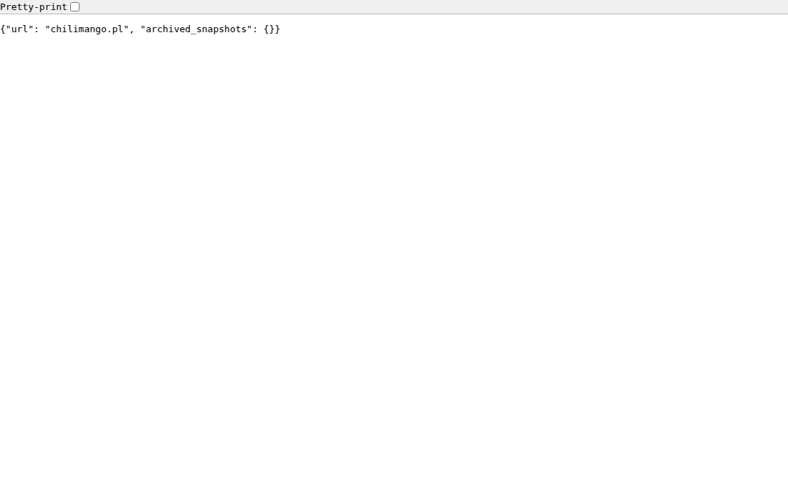
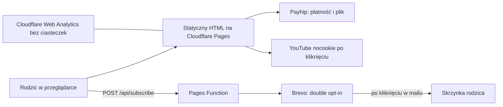
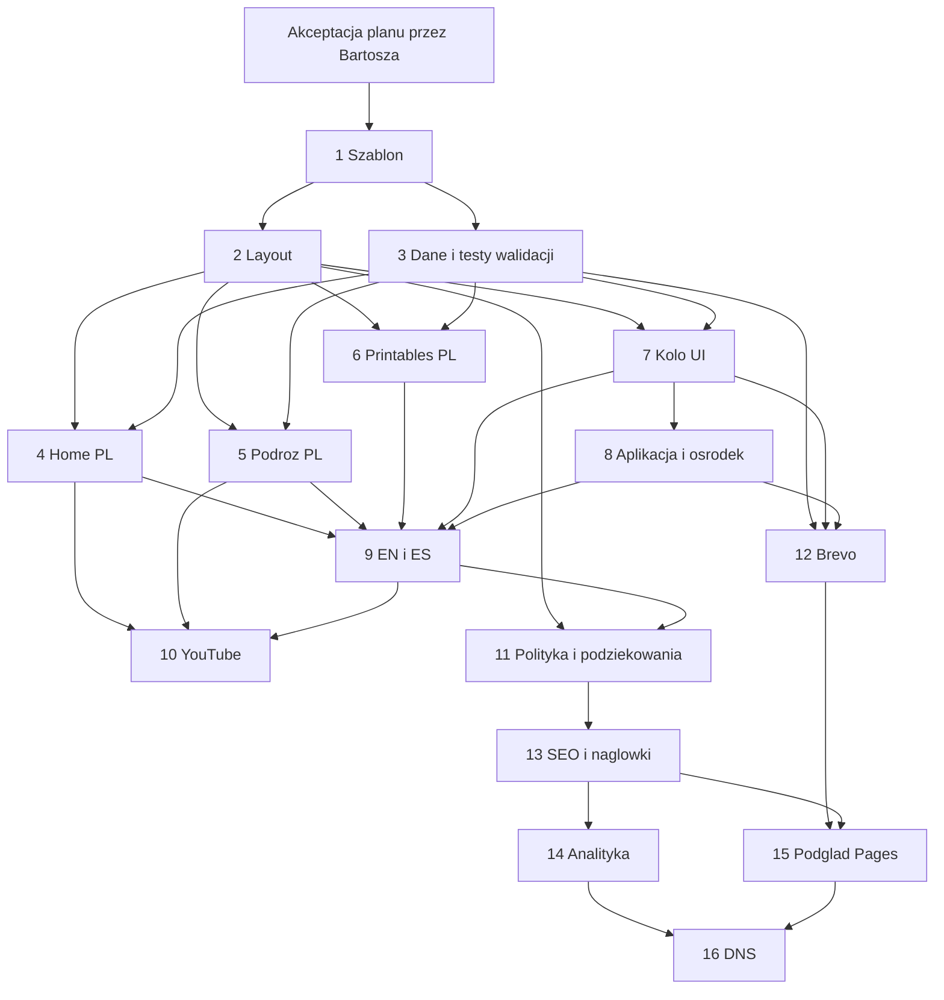

# Strona chilimango.pl — plan i specyfikacja v1

> **Dla agentów implementujących:** REQUIRED SUB-SKILL: Use superpowers:subagent-driven-development (zalecane) albo superpowers:executing-plans, zadanie po zadaniu. Kroki mają checkboxy (`- [ ]`).
>
> **Ten dokument nie jest wdrożeniem.** Kod aplikacji powstaje dopiero po akceptacji planu przez Bartosza Gawrona. Pull request z tym plikiem nie zmienia aplikacji.

**Cel:** Opublikować statyczną, trójjęzyczną stronę marki Chilimango pod domeną chilimango.pl, która prowadzi rodziców w Polsce do darmowego koła emocji (zapis na newsletter) i do zakupu printables na Payhip, a osoby zainteresowane późniejszą aplikacją i ośrodkiem zbiera na osobne listy oczekujących.

**Architektura:** Puste repozytorium `frontend` staje się stroną Astro 7 o wyniku czysto statycznym. Formularze obsługuje jedna funkcja Cloudflare Pages, która woła Brevo i nie zapisuje adresów w gicie. Płatności zostają na Payhip. Domena zostaje zarejestrowana w nazwa.pl, a DNS i hosting idą na darmowy plan Cloudflare.

**Tech stack:** Astro 7.4.0, TypeScript, Node `>=22.22.0`, npm, Cloudflare Pages (plan Free), Cloudflare Email Routing, Brevo (plan Free), Payhip (linki zewnętrzne), Cloudflare Web Analytics.

## Globalne ograniczenia

Każde zadanie implementacyjne dziedziczy tę listę.

- Implementacja startuje dopiero po wyraźnej akceptacji tego planu przez Bartosza Gawrona.
- Wersja Astro pinowana: `astro@7.4.0` (`npm view astro@7.4.0 version` w dniu 2026-10-17 zwróciło `7.4.0`; `engines.node` to `>=22.22.0`).
- Wynik buildu: statyczny HTML (`output: 'static'`). Brak bazy danych, kont użytkowników i koszyka.
- Język źródłowy treści: polski. Angielski i hiszpański są tłumaczeniem tego polskiego tekstu, nie osobną obietnicą.
- Adresy stron są takie same we wszystkich językach: `/`, `/podroz`, `/printables`, `/kolo-emocji`, `/aplikacja`, `/osrodek`, `/polityka-prywatnosci`, `/dziekujemy`, `/dziekujemy-aplikacja`, `/dziekujemy-osrodek`. Angielski ma prefiks `/en`, hiszpański `/es`. Polski nie ma prefiksu.
- Żadne zdjęcie, kadr ani nagranie, na którym da się rozpoznać dziecko, nie wchodzi do repozytorium ani na stronę. Zamazywanie robi Bartosz przed przekazaniem pliku.
- Formularze zbierają wyłącznie e-mail dorosłego, język strony i jeden cel zapisu. Nie ma pola na imię dziecka, wiek, szkołę ani adres zamieszkania rodziny.
- Plik koła emocji nie leży w `public/` ani w gicie. Dostarcza go Brevo po potwierdzeniu adresu.
- Klucze API nie wchodzą do gita. Sekrety są tylko w zmiennych Cloudflare.
- Strona nie przyjmuje płatności i nie podaje ceny, której nie ma w `src/data/products.ts`.
- Pusta lista produktów albo filmów ukrywa przyciski i odtwarzacze. Nie ma przycisków „wkrótce” prowadzących donikąd.
- Tekst o ośrodku i o aplikacji mówi, że to plany. Zapis nie jest rezerwacją i nic nie kosztuje.
- Ten dokument nie jest poradą prawną, podatkową ani księgową.

## Status

| Pole | Wartość |
| --- | --- |
| Data rozpoznania | 17 października 2026 |
| Właściciel akceptacji | Bartosz Gawron |
| Repo | `bartosz-gawron/frontend`, gałąź bazowa `main`, jeden commit `96190f8` „Initial commit” |
| Wynik tego etapu | wyłącznie ten plik i zrzuty w `docs/plans/assets/` |
| Następny krok | komentarz Bartosza na pull requeście: akceptuję albo lista zmian |

Szacunek wielkości zadań poniżej nie jest czasem kalendarzowym. **S** oznacza jedną sesję jednego agenta i jeden przeglądalny zestaw zmian.

---

## 1. Cel biznesowy i rola strony

Chilimango to jednoosobowa marka Bartosza z Gdyni. Strona v1 ma zrobić trzy rzeczy:

1. Pokazać, kim jest marka: podróże z córkami i seria „budujemy od zera”.
2. Sprzedać printables o emocjach rodzinom w Polsce. Koszyk jest na Payhip, strona tylko do niego prowadzi.
3. Zebrać adresy: newsletter z darmowym kołem emocji, lista na aplikację z personalizowanymi książkami, lista na ośrodek „Casa Chilimango / Chilimango Family Retreat”.

Cel firmy podany w zleceniu: **6000 zł przychodu miesięcznie po 12 miesiącach** ze sprzedaży printables rodzinom w Polsce. To cel firmy, nie kryterium odbioru strony. Strona jest odebrana, gdy spełnia kryteria z sekcji 13, niezależnie od utargu.

Arytmetyka, nie prognoza popytu: 6000 zł przychodu miesięcznie to około 207 sprzedaży przy 29 zł, 154 przy 39 zł albo 122 przy 49 zł. Cen produktów jeszcze nie ma. Te trzy liczby służą tylko temu, żeby strona główna prowadziła do oferty, a nie była wizytówką bez ścieżki zakupu.

Limit działalności nierejestrowanej w 2026 r. to **10 813,50 zł przychodu należnego na kwartał** (225% minimalnego wynagrodzenia 4806 zł brutto). Źródła: [podatki.gov.pl](https://www.podatki.gov.pl/poradniki-i-informatory/dzialalnosc-nierejestrowana) i [gov.pl, pas startowy](https://www.gov.pl/web/rozwoj-technologia/pas-startowy-dla-poczatkujacych-firm). 6000 zł miesięcznie przez pełny kwartał daje 18 000 zł, czyli powyżej tego limitu. Decyzja o CEIDG należy do Bartosza i księgowej, zanim utarg dojdzie do progu. Strona ma pole na formę prawną, żeby stopka mogła pokazać albo NIP, albo informację o działalności nierejestrowanej.

## 2. Co jest w repozytorium

Stan na 2026-10-17:

- Remote: `origin` → `origin.cursor.com/git/bartosz-gawron/frontend.git` (Origin, nie GitHub i nie GitLab).
- Gałąź `main`, working tree czysty, jeden commit.
- Jedyny plik aplikacji: `README.md` o treści `# frontend`.
- Brak `package.json`, frameworka, CI, treści o Chilimango, layoutu i konfiguracji hostingu.

Wniosek: nie ma stosu, do którego trzeba się dopasować. Strona v1 zajmuje korzeń tego repozytorium. Osobny monorepo i katalog `apps/` nic teraz nie dają. Przyszła aplikacja z książkami dostaje własne repozytorium, gdy naprawdę powstanie. Do tego czasu `frontend` jest stroną chilimango.pl.

`README.md` w zadaniu 1 przestaje być samym nagłówkiem „frontend” i opisuje, jak zbudować stronę oraz wskazuje ten plan.

## 3. Archiwum dawnej strony

### 3.1. Internet Archive

Nie ma czego odtworzyć. W dniu 2026-10-17 archiwum nie ma żadnego snapshotu `chilimango.pl`.

Zapytania, które zwróciły pusty wynik:

- Availability API: [https://archive.org/wayback/available?url=chilimango.pl](https://archive.org/wayback/available?url=chilimango.pl) → `{"url": "chilimango.pl", "archived_snapshots": {}}`. To samo dla `http://chilimango.pl` i `https://www.chilimango.pl`.
- CDX, dopasowanie prefix: `https://web.archive.org/cdx/search/cdx?url=chilimango.pl&matchType=prefix&output=json` → `[]`.
- CDX z zakresem dat 2000–2026 → `[]`.
- CDX `*.chilimango.pl` → `[]`.
- Timemap `https://web.archive.org/web/timemap/link/http://chilimango.pl` → puste ciało, nagłówek `x-na: 0`.
- Kalendarz `https://web.archive.org/web/2020/http://chilimango.pl/` i `https://web.archive.org/web/20240000000000/http://chilimango.pl/` → HTTP 404.

Jedno zapytanie CDX `matchType=domain` wpadło w stronę „Internet Archive: Temporarily Offline”. Ten pojedynczy strzał jest nieważny. Reszta zapytań, które doszły, jest pusta.

Zrzut odpowiedzi Availability API:



Wspólne Crawl, indeksy które odpowiedziały „No Captures found”:

- `CC-MAIN-2017-39-index`
- `CC-MAIN-2020-50-index`
- `CC-MAIN-2024-51-index`
- `CC-MAIN-2025-33-index`

Indeksy `CC-MAIN-2019-35`, `CC-MAIN-2022-40` i `CC-MAIN-2026-39` zwróciły 502/504. Nie traktuję ich jako dowodu, że zrzuty istnieją. urlscan.io w oknie 30 dni: 0 wyników (to nie jest historia sprzed października 2026). archive.ph zwrócił HTTP 429, więc stamtąd nie ma wniosku.

**Nie ma linku do snapshotu, bo snapshotu nie ma.** Nie ma też czego zachować z wyglądu: struktury, tekstów, kolorów ani logo dawnej witryny.

### 3.2. Co wisi pod domeną dzisiaj

Domena odpowiada, ale nie jest stroną Chilimango. To parking nazwa.pl.

Zaobserwowane 2026-10-17, zapytania DNS i HTTP:

| Rekord | Wartość |
| --- | --- |
| A | `85.128.128.104` |
| NS | `ns1.nazwa.pl`, `ns2.nazwa.pl`, `ns3.nazwa.pl` |
| MX | `10 chilimango.pl` (poczta wskazuje na samą domenę) |
| TXT | `v=spf1 mx a ~all` |
| HTTP | `http://chilimango.pl/` → 200, szablon „blackdown” nazwa.pl |
| HTTPS | błąd certyfikatu: nazwa `chilimango.pl` nie jest w certyfikacie |

HTML parkingu ładuje iframe `https://blackdown.nazwa.pl/?source=blackdown-kf&d=chilimango.pl`. Tytuł: „Domena chilimango.pl jest utrzymywana na serwerach nazwa.pl”. W stopce: „chilimango.pl utrzymywana jest na serwerach nazwa.pl”. Reszta widoku to reklama nazwa.pl („Domeny za 0 zł”, wyszukiwarka domen, zdjęcia stockowe dorosłych ludzi, pasy niebieski / żółty / róż / pomarańcz).


Tego wyglądu nie przenosimy. To szablon rejestratora, nie identyfikacja marki. Zdjęcia stockowe z parkingu nie są materiałem Chilimango.

### 3.3. Ślad publiczny marki, który nie jest snapshotem strony

Jedyny opis marki, który udało się znaleźć poza zleceniem, to wywiad „How to Travel Europe During COVID Pandemic?” na Sunday in Wonderland: [sundayinwonderland.com, wywiad z Martą i Bartkiem](https://sundayinwonderland.com/travel-inspiration/how-to-travel-europe-during-covid-pandemic-tips-from-digital-nomads/). Indeks wyszukiwarki podaje, że Marta i Bartek z Gdyni nagrywali podróże jako Chilimango, mieszkali z kotami Jadwigą i Ryszardą, a Bartek zajmował się programowaniem. Ponowne pobranie strony 2026-10-17 skończyło się błędem Cloudflare 525, więc opieram się na zindeksowanym fragmencie, nie na świeżo przeczytanym artykule. Wywiad nie podaje adresu chilimango.pl ani palety kolorów.

Zlecenie na v1 opisuje markę jako jednoosobową firmę Bartosza i podróże z córkami (3 i 5 lat). Tekst strony idzie za zleceniem, nie za wywiadem z 2020 r. Decyzja D4 mówi, czy strona w ogóle wspomina Martę.

Nie mylić z barem Chilimango w Saragossie (Calle Santa Cruz 11). Nie bierzemy stamtąd zdjęć, neonów ani opisów. Nie znalazłem dowodu, że tropikey.com to ta sama witryna co chilimango.pl. Treści TropiKey nie przenosimy.

Nie znalazłem pewnego adresu kanału YouTube. Odtwarzacze zostają puste, aż Bartosz poda identyfikatory filmów.

### 3.4. Co warto zachować

| Element | Decyzja |
| --- | --- |
| Nazwa Chilimango i domena | tak |
| Gdynia jako miejsce marki | tak, bez adresu domu i bez szkoły dzieci |
| Podróże, filmy, seria „budujemy od zera” | tak, jako treść, gdy będą identyfikatory filmów |
| Trójjęzyczność PL/EN/ES | tak, jako języki strony i produktów |
| Wygląd, kolory, logo, układ dawnej strony | nie ma źródła, więc nie ma czego kopiować |
| Parking nazwa.pl | nie |
| Imiona kotów, imię Marty, wiek córek | tylko jeśli Bartosz zaznaczy to w decyzjach D4 i D5 |

Nowa identyfikacja, skoro archiwum jest puste:

- Tło `--cream` `#FFF8F0`, tekst `--ink` `#2A2118`. Zmierzone pokrycie kontrastu: 15.0:1.
- Akcent chili `--chili` `#C23B22`. Biały tekst na tym tle: 5.33:1. Przyciski mogą użyć białego tekstu. Nie rozjaśniać tego koloru.
- Mango `--mango` `#F2A03D` tylko z tekstem `--ink` (7.43:1), nigdy z białym tekstem.
- Liść `--leaf` `#2F6B4F` z białym tekstem (6.29:1) na drugorzędne przyciski.
- Papier kart `--paper` `#FFFFFF`.
- Logo v1: wordmark „Chilimango” plus prosty znak SVG (owoc i papryka jako dwa płaskie kształty narysowane od zera). To zastępnik, dopóki Bartosz nie poda własnego znaku.
- Fonty self-host, licencja OFL, bez żądania do Google Fonts w przeglądarce: Fraunces na nagłówki, Source Sans 3 na tekst.
- Hero jest typograficzny. Nie ma zdjęcia dzieci, dopóki Bartosz nie wgra plików już zamazanych.

## 4. Zakres MVP

Strony, każda po polsku, angielsku i hiszpańsku:

| Ścieżka PL | Rola |
| --- | --- |
| `/` | Obietnica marki, skrót oferty, koło emocji, filmy jeśli są, dwie zapowiedzi (aplikacja, ośrodek) |
| `/podroz` | O marce i podróżach, seria „budujemy od zera”, filmy jeśli są |
| `/printables` | Karty produktów i linki „Kup na Payhip”. Pusta lista produktów daje opis oferty i link do koła emocji |
| `/kolo-emocji` | Darmowe koło emocji w zamian za potwierdzony zapis na newsletter |
| `/aplikacja` | Lista oczekujących na aplikację z personalizowanymi książkami |
| `/osrodek` | Lista oczekujących na Casa Chilimango / Chilimango Family Retreat |
| `/polityka-prywatnosci` | Polityka prywatności |
| `/dziekujemy`, `/dziekujemy-aplikacja`, `/dziekujemy-osrodek` | Potwierdzenie wysłania formularza, bez informacji czy adres już był na liście |

Wspólne:

- Przełącznik PL / EN / ES linkami, atrybut `lang` na `<html>`.
- Stopka z danymi operatora, mailem i linkiem do polityki.
- Filmy YouTube przez fasadę: obrazek i przycisk, iframe `youtube-nocookie.com` dopiero po kliknięciu.
- Formularze z osobną, odznaczoną zgodą na jeden cel.
- Mapa strony, `hreflang`, kanoniczne adresy, Open Graph.
- Analityka bez ciasteczek, opisana w polityce.
- Podgląd na Cloudflare Pages i podpięcie domeny instrukcją z sekcji 8.

## 5. Poza zakresem v1

- Własny koszyk, płatności, faktury, konta klientów, kody rabatowe.
- Aplikacja książek, generowanie PDF, konta rodzin, logowanie.
- Rezerwacje ośrodka, cennik pobytu, kalendarz, zdjęcia nieistniejącego obiektu, zbieranie zadatku.
- Blog, CMS, konto redaktora, komentarze.
- Przetłumaczone slugi (`/en/travel`). Zostają te same człony ścieżki.
- Piksel Meta, Google Analytics, Hotjar, czat.
- Captcha.
- Automatyczne tłumaczenie w przeglądarce i publikacja maszynowego tłumaczenia bez czytania.
- Przenoszenie treści z TropiKey albo z baru w Saragossie.
- Monorepo i szkielet przyszłej aplikacji.
- Automatyczny deploy z Origin. Host git tego repozytorium nie jest GitHubem ani GitLabem, a z takich połączeń korzysta integracja Git w Cloudflare Pages. Deploy v1 jest poleceniem Wranglera (sekcja 8).

## 6. Treść i stany puste

Dane edytowalne bez przebudowy komponentów:

`src/data/site.ts`

```ts
export const site = {
  url: "https://chilimango.pl",
  brand: "Chilimango",
  operator: {
    legalForm: "" as "" | "jdg" | "nierejestrowana",
    name: "",
    addressLines: [] as string[],
    email: "",
    nip: "",
  },
  leadMagnetReady: false,
  waitlistReady: false,
  legalApproved: false,
  youtubeChannelUrl: "",
} as const;
```

`src/data/products.ts`

```ts
export type Locale = "pl" | "en" | "es";
export type Product = {
  id: string;
  title: Record<Locale, string>;
  summary: Record<Locale, string>;
  priceLabel: string;
  payhipUrl: string;
  languages: Locale[];
};
export const products: Product[] = [];
```

`src/data/videos.ts`

```ts
export type Video = {
  youtubeId: string;
  title: Record<"pl" | "en" | "es", string>;
  placement: Array<"home" | "podroz">;
};
export const videos: Video[] = [];
```

Reguły walidacji w teście:

- `payhipUrl` pasuje do `^https://(www\.)?payhip\.com/`.
- `youtubeId` pasuje do `^[A-Za-z0-9_-]{11}$`.
- `priceLabel` jest niepusty, gdy produkt istnieje. Cena na stronie jest napisem z tego pola, nie wyliczeniem.
- `leadMagnetReady === true` jest dozwolone tylko razem z niepustymi `operator.name`, `operator.email`, `operator.addressLines` i `operator.legalForm`.
- `legalForm === "jdg"` wymaga niepustego `nip` (10 cyfr).
- `legalApproved === false` dodaje na górze polityki zdanie, że to projekt do akceptacji, i ustawia `<meta name="robots" content="noindex">` na każdej stronie. Po `legalApproved === true` meta `noindex` znika, o ile dane operatora są uzupełnione. Zadanie 16 i tak nie podpina domeny wcześniej.

### 6.1. Strona główna

Kolejność sekcji:

1. **Hero.** Nagłówek wersji roboczej PL: „Chilimango. Podróże z dziećmi i pomoce, które nazywają emocje.” Akapit wersji roboczej: „Nazywam się Bartosz. Chilimango to moja marka z Gdyni. Nagrywam wyjazdy z córkami i składam proste materiały o emocjach po polsku, angielsku i hiszpańsku.” Dwa linki: „Weź koło emocji” → `/kolo-emocji`, „Zobacz printables” → `/printables`.
2. **Dla kogo.** Rodzice, którzy chcą nazywać emocje z dzieckiem. Produkty są dla rodzin. Formularz jest dla dorosłego.
3. **Printables.** Do trzech kart z `products`. Pusta tablica: jeden akapit, że materiały o emocjach będą sprzedawane na Payhip, i link do koła emocji. Zero przycisków kupna.
4. **Koło emocji.** Jedno zdanie o darmowym kole i link do `/kolo-emocji`.
5. **Filmy.** Render tylko gdy `videos` ma element z `placement` zawierającym `home`. Inaczej sekcja nie istnieje w HTML.
6. **Budujemy od zera.** Krótki opis serii: powstawanie marki i materiałów od zera, bez obietnicy daty odcinka.
7. **Dwie zapowiedzi.** Aplikacja i ośrodek, każdy z jednym zdaniem „to plan, zapis nic nie kosztuje” i linkiem do własnej strony.

### 6.2. Podróż

- Kim jest marka (tekst z hero, rozwinięty).
- Jak powstają filmy: podróże z córkami, twarze dzieci na materiałach publikowanych są zamazane. Bez imion dzieci, bez wieku, bez daty wyjazdu i bez nazwy szkoły, dopóki decyzja D5 nie powie inaczej.
- Seria „budujemy od zera”.
- Filmy z `placement: "podroz"`. Brak filmów: sekcja odtwarzacza nie jest renderowana, zostaje tekst.

### 6.3. Printables

- Każdy produkt: tytuł, dwa–trzy zdania, języki, `priceLabel`, link „Kup na Payhip” otwierany w nowej karcie (`rel="noopener noreferrer"`).
- Pod kartami zdanie: „Zakup odbywa się na Payhip. Tam jest płatność, dostawa pliku i warunki sprzedaży.”
- Pusta lista: opis, że szykowane są printables o emocjach po polsku, angielsku i hiszpańsku, oraz link do koła. Żadnej zmyślonej ceny.

### 6.4. Koło emocji

Gdy `leadMagnetReady === false`: opis koła (jednostronicowy printable do nazywania emocji, PL/EN/ES) i zdanie „Wysyłka jeszcze nie działa”. Brak pola e-mail.

Gdy `leadMagnetReady === true`: formularz z sekcji 9, cel `newsletter`.

### 6.5. Aplikacja i ośrodek

Wspólny komponent `Waitlist`, różny `purpose` i różne zdania:

- Aplikacja: personalizowane książki o emocjach. „Aplikacji jeszcze nie ma. Zapis jest darmowy i nie rezerwuje dostępu.”
- Ośrodek: „Casa Chilimango / Chilimango Family Retreat” jako przyszły ośrodek odnowy. „Ośrodka jeszcze nie ma. Zapis nie jest rezerwacją, nie wybiera terminu i nic nie kosztuje.”

Brak zdjęć obiektu, mapy dojazdu, liczby miejsc i cen pobytu.

### 6.6. Teksty zgód (kanoniczne, PL)

Newsletter, checkbox odznaczony:

> Chcę dostawać na ten adres informacje o materiałach Chilimango i dostać koło emocji. Wiem, że mogę zrezygnować w każdej chwili.

Aplikacja:

> Chcę wiadomość, gdy aplikacja z książkami o emocjach będzie dostępna. Wiem, że aplikacja jeszcze nie istnieje i że zapis nic nie kosztuje.

Ośrodek:

> Chcę wiadomość, gdy ośrodek Casa Chilimango zacznie przyjmować zgłoszenia. Wiem, że to nie jest rezerwacja i że nic teraz nie płacę.

Angielski i hiszpański tłumaczą te trzy zdania sens w sens. Nie wolno dodać czwartej zgody „na wszystko”.

### 6.7. Wersje robocze EN i ES hero

EN: „Chilimango. Family trips and tools that give feelings a name.” / „My name is Bartosz. Chilimango is my brand from Gdynia. I film trips with my daughters and I make simple feelings printables in Polish, English, and Spanish.”

ES: „Chilimango. Viajes con niñas y materiales que ponen nombre a las emociones.” / „Me llamo Bartosz. Chilimango es mi marca de Gdynia. Grabo los viajes con mis hijas y preparo materiales sencillos sobre emociones en polaco, inglés y español.”

To wersje robocze do korekty Bartosza. Hiszpański „niñas” zakłada córki, zgodnie ze zleceniem.

## 7. Architektura i wybór stosu

### Opcja A — rekomendowana

Astro 7.4.0 w korzeniu repozytorium, statyczny build, funkcja Cloudflare Pages tylko dla `POST /api/subscribe`, hosting Cloudflare Pages Free, DNS w Cloudflare, rejestracja domeny zostaje w nazwa.pl.

Dlaczego: strona jest treścią i linkami. Astro oddaje HTML bez frameworka w przeglądarce. Node wymagany przez ten pakiet to `>=22.22.0`. i18n jest wbudowane ([dokumentacja Astro i18n](https://docs.astro.build/en/guides/internationalization/)). Plan Free Cloudflare Pages, według [pages.cloudflare.com](https://pages.cloudflare.com/) i [limitów](https://developers.cloudflare.com/pages/platform/limits/) (aktualizacja docs: 5 września 2026): 0 USD, 500 buildów miesięcznie, 1 build naraz, 100 domen własnych na projekt, statyczne żądania i transfer bez limitu, do 20 000 plików, plik do 25 MiB. Żądania do funkcji liczą się do limitu Workers Free; sam HTML się nie liczy ([cennik funkcji](https://developers.cloudflare.com/pages/functions/pricing/)).

Użycie komercyjne planu Free: w wątku z 20 maja 2026 odpowiedź brzmi, że plan Free jest używany do stron firmowych, a wcześniejsza odpowiedź odsyła do Self-Serve Subscription Agreement, sekcja 2.2.1, bez zakazu takiego użytku ([wątek](https://community.cloudflare.com/t/use-free-plan-for-commercial-project-follow-up/732438)). To nie jest tekst samej umowy. Bartosz i tak rzuca okiem na aktualną umowę przy zakładaniu konta. Plan Free nie ma SLA.

### Opcja B — odrzucona na v1

Hosting WordPress albo CloudHosting w nazwa.pl. [Cennik CloudHosting WordPress](https://www.nazwa.pl/cennik/cennik-cloudhosting-wordpress/) w dniu rozpoznania podaje w „Cenniku standardowym” Start 75 PLN/m-c, Biznes 150 PLN/m-c, Pro 300 PLN/m-c. Ta sama strona pisze: „Do cen netto należy doliczyć 23% VAT”. Jest też promocja pierwszego okresu. Statyczna strona nie potrzebuje tego hostingu ani WordPressa. Zostawiamy nazwa.pl jako rejestratora.

### Opcja C — odrzucona na v1

Next.js od razu, „żeby potem była aplikacja”. Aplikacja jest poza v1 i ma dostać własne repozytorium. Next na stronie-wizytówce dokłada serwer i JS, którego MVP nie używa.

### Przepływ



### Mapa plików, którą utworzą zadania implementacyjne

```
package.json
package-lock.json
astro.config.mjs
tsconfig.json
README.md
public/fonts/            # Fraunces i Source Sans 3, OFL
public/favicon.svg
public/robots.txt        # generowany albo statyczny, patrz zadanie 13
src/styles/global.css
src/layouts/Base.astro
src/components/Header.astro
src/components/Footer.astro
src/components/Wordmark.astro
src/components/ProductCard.astro
src/components/YoutubeFacade.astro
src/components/SubscribeForm.astro
src/i18n/ui.ts
src/lib/subscribe.ts     # walidacja współdzielona z funkcją i testami
src/data/site.ts
src/data/products.ts
src/data/videos.ts
src/pages/index.astro
src/pages/podroz.astro
src/pages/printables.astro
src/pages/kolo-emocji.astro
src/pages/aplikacja.astro
src/pages/osrodek.astro
src/pages/polityka-prywatnosci.astro
src/pages/dziekujemy.astro
src/pages/dziekujemy-aplikacja.astro
src/pages/dziekujemy-osrodek.astro
src/pages/en/...         # te same pliki
src/pages/es/...
src/pages/404.astro
functions/api/subscribe.ts
src/lib/subscribe.test.ts
```

`astro.config.mjs`: `site: "https://chilimango.pl"`, `output: "static"`, `i18n.locales: ["pl", "en", "es"]`, `defaultLocale: "pl"`, `prefixDefaultLocale: false`, `trailingSlash: "never"`.

Skrypty npm: `dev`, `build`, `preview`, `test`.

## 8. Hosting, deploy, DNS, poczta

### Deploy

1. Bartosz zakłada konta Cloudflare i tworzy token z uprawnieniem do Pages.
2. Agent, po akceptacji planu, tworzy projekt Pages o nazwie `chilimango` poleceniem Wranglera i wgrywa katalog `dist`.
3. Kolejne wdrożenia: `npm run build`, potem `npx wrangler pages deploy dist --project-name chilimango`.
4. Gałąź podglądowa dostaje osobny adres `*.pages.dev`. Domena produkcyjna dostaje wdrożenie tylko z `main` i tylko po spełnieniu kryteriów odbioru.

Automatyczne budowanie z każdego pusha wymaga hosta git, którego Cloudflare Pages łączy (GitHub albo GitLab). To repozytorium jest na Origin. Lustrzany GitHub jest opcją na później, nie częścią v1.

### DNS

Rejestracja zostaje w nazwa.pl. Autorytatywny DNS idzie na Cloudflare, bo Email Routing i proxy wymagają tej delegacji.

Instrukcja dla Bartosza, według [pomocy nazwa.pl](https://www.nazwa.pl/pomoc/baza-wiedzy/zmiana-delegacji-domeny/) i [dokumentacji Cloudflare](https://developers.cloudflare.com/dns/zone-setups/full-setup/setup/):

1. Wyłączyć DNSSEC w panelu nazwa.pl, jeśli jest włączony. Delegacja przy włączonym DNSSEC potrafi uciąć domenę.
2. Dodać strefę `chilimango.pl` na planie Free w Cloudflare i przepisać istniejące rekordy, zanim zmienią się serwery nazw.
3. W nazwa.pl: Usługi → Domeny → konfiguruj → Zewnętrzne serwery DNS. Wpis co najmniej dwóch NS podanych przez Cloudflare. Zapisać przyciskiem ZMIEŃ.
4. nazwa.pl ostrzega, że zewnętrzne DNS wyłącza pakiet „Bezpieczna domena”: DNSSEC nazwa.pl, Anycast nazwa.pl oraz SPF, DKIM i DMARC po ich stronie. Dlatego SPF i poczta są ustawiane od nowa w Cloudflare, a nie „zostają same”.
5. Propagacja według nazwa.pl około 24 godzin. Cloudflare pisze o tym samym rzędzie wielkości.

Rekordy, które mają być w Cloudflare po przełączeniu, a przed podmianą strony:

- Obecne MX `10 chilimango.pl` i TXT `v=spf1 mx a ~all` wyglądają na domyślny parking, nie na skrzynkę, której ktoś używa. **D2 musi to potwierdzić.** Jeśli skrzynki nie ma, tych rekordów nie kopiujemy. Jeśli jest, kopiujemy je 1:1 i nie włączamy Email Routing, dopóki Bartosz nie zdecyduje, gdzie ma iść poczta.
- Po decyzji „nie mam skrzynki na nazwa.pl”: włączyć [Cloudflare Email Routing](https://developers.cloudflare.com/email-routing/). Usługa jest na planach Free i Paid. Przychodząca poczta jest bez limitu i bez opłaty; wysyłka do dowolnych odbiorców wymaga Workers Paid ([cennik Email Service](https://developers.cloudflare.com/email-service/platform/pricing/), aktualizacja 9 czerwca 2026). Na v1 wystarczy przekierowanie `kontakt@chilimango.pl` na prywatną skrzynkę Bartosza. Wysyłki marketingowej stąd nie ma: maile do klientów wysyła Brevo.
- A/AAAA albo CNAME strony: rekordy, które Cloudflare Pages pokaże przy dodawaniu domeny własnej. Apex i `www` wskazują na Pages. `www` przekierowuje na apex trwałym przekierowaniem.
- TXT weryfikacyjne Pages i Brevo, gdy panele je pokażą.
- Po włączeniu Email Routing Cloudflare sam dopisze MX i TXT. Nie mieszać ich z starym MX na `chilimango.pl`.

HTTPS: certyfikat wystawia Cloudflare przy podpiętej domenie. Dzisiejszy błąd certyfikatu na parkingu znika razem z parkingiem.

### Czego agent nie klika

Panel nazwa.pl, akceptacja umów Cloudflare, utworzenie tokenu, potwierdzenie że stara poczta jest pusta, weryfikacja docelowej skrzynki Email Routing. To są kroki Bartosza w zadaniu 16.

## 9. Formularze i newsletter

Jedno konto Brevo, plan Free. Według [opisu limitów Free](https://help.brevo.com/hc/en-us/articles/208580669-FAQs-What-are-the-limits-of-the-Free-plan): 300 wysłanych wiadomości dziennie, niewykorzystane sztuki nie przechodzą na kolejny dzień. [Opis planów](https://help.brevo.com/hc/en-us/articles/208589409-About-Brevo-s-pricing-plans) podaje też do 100 000 kontaktów na Free. Kampania większa niż 300 osób wymaga ręcznego „Requeue”. Przy starcie listy to wystarcza. Alternatywa MailerLite Free, według [mailerlite.com/free-plan](https://www.mailerlite.com/free-plan): 250 subskrybentów i 2500 wiadomości miesięcznie. Odrzucam ją, bo koło emocji ma rosnąć powyżej 250 adresów bez od razu płatnego planu.

Brevo jest procesorem. Bartosz klika ich umowę powierzenia w panelu, zanim `leadMagnetReady` stanie się `true`.

### Kontrakt `POST /api/subscribe`

Żądanie JSON:

```json
{
  "email": "rodzic@example.com",
  "locale": "pl",
  "purpose": "newsletter",
  "consent": true,
  "company": ""
}
```

- `purpose`: `newsletter` | `app` | `retreat`.
- `locale`: `pl` | `en` | `es`.
- `consent` musi być dokładnie `true`.
- `company` to honeypot. Niepuste → HTTP 200 i zero wywołań Brevo.
- E-mail: jeden `@`, część domeny z kropką, długość 3–254, bez spacji. Świadomie prosta reguła, bez „poprawiania” adresu.
- Odpowiedź sukcesu zawsze HTTP 200 i `{ "ok": true }`, także gdy Brevo zgłosi duplikat. Treść nie zdradza, czy adres istnieje.
- Błąd walidacji: HTTP 400 i `{ "ok": false, "error": "invalid" }`.
- Brak zgody: HTTP 400 i `{ "ok": false, "error": "consent" }`.
- Powyżej 5 żądań z jednego IP w ciągu godziny: HTTP 429.
- Brak `BREVO_API_KEY` albo `leadMagnetReady === false` przy `purpose === "newsletter"`: HTTP 404, a formularz w HTML w ogóle nie jest renderowany. To podwójna blokada.
- Listy oczekujących działają przy uzupełnionym operatorze, nawet gdy koło emocji jeszcze nie ma pliku. Flaga `waitlistReady` w `site.ts`, domyślnie `false`, ten sam wymóg danych operatora.

Wysyłka do Brevo używa aktualnego endpointu double opt-in z [dokumentacji developers.brevo.com](https://developers.brevo.com/). Kontakt nie dostaje treści marketingowej przed kliknięciem linku potwierdzającego. Atrybuty kontaktu: `LOCALE`, `PURPOSE`. Trzy listy albo trzy atrybuty, byle filtr automatyzacji umiał rozdzielić koło, aplikację i ośrodek.

Po potwierdzeniu celu `newsletter` automatyzacja Brevo wysyła mail z linkiem do pliku koła. Plik leży w Brevo, nie w repozytorium. Automatyzację klika Bartosz według checklisty zadania 12. Agent dostarcza treść maila po polsku, angielsku i hiszpańsku w `docs/email/kolo-emocji.md` (to powstanie w tamtym zadaniu, nie w tym pull requeście).

Strony podziękowania:

- „Jeśli ten adres jest poprawny, wyślemy prośbę o potwierdzenie. Nic nie wyślemy, dopóki nie klikniesz linku w mailu.”
- Wariant aplikacji i ośrodka mówi o potwierdzeniu zapisu na listę, nie o wysyłce pliku.

## 10. Analityka i ciasteczka

MVP nie ma banera zgody, bo nie wkłada niczego do urządzenia użytkownika przed świadomym kliknięciem.

- Cloudflare Web Analytics: beacon nie używa ciasteczek, `localStorage`, `sessionStorage` ani IndexedDB i nie buduje odcisku z IP ani User-Agent. IP jest odrzucane na brzegu. Źródło: [dokumentacja Web Analytics](https://developers.cloudflare.com/web-analytics/) i [opis beacona RUM](https://developers.cloudflare.com/speed/observatory/rum-beacon/).
- Domyślne włączenie na planie Free pomija ruch z UE ([wpis Cloudflare](https://blog.cloudflare.com/the-rum-diaries-enabling-web-analytics-by-default/)). Dla strony o odbiorcach w Polsce Bartosz w panelu wybiera wariant, który **zbiera także odwiedziny z UE**. Inaczej licznik nie widzi rodzin, do których strona jest skierowana. Polityka prywatności o tym mówi. Podstawa w polityce: prawnie uzasadniony interes, opisany prostym językiem, plus informacja z art. 6 ustawy o świadczeniu usług drogą elektroniczną o programie wczytywanym do urządzenia (beacon).
- YouTube: do kliknięcia nie ma iframe. Po kliknięciu iframe ma źródło `https://www.youtube-nocookie.com/embed/{id}`. Obok przycisku zdanie: „Odtworzenie ładuje film z YouTube i może zapisać ciasteczka YouTube.” Kliknięcie jest świadomym żądaniem tej treści.
- Brak pikseli reklamowych. Gdyby doszedł skrypt, który zapisuje informacje w urządzeniu, najpierw trzeba zgody z art. 399 Prawa komunikacji elektronicznej (Dz.U. 2024 poz. 1221), zanim skrypt się załaduje. To osobne, przyszłe zadanie, poza v1.
- Payhip i Brevo mają własne statystyki kliknięć i zapisów. v1 nie dokładuje do tego zdarzeń w przeglądarce.

## 11. Payhip

Strona nie jest sklepem. Karta produktu linkuje do gotowego adresu Payhip.

Cennik Payhip, [payhip.com/pricing](https://payhip.com/pricing): plan Free 0 USD miesięcznie i 5% od transakcji; Plus 29 USD i 2%; Pro 99 USD i 0% prowizji Payhip. Na każdym planie zostaje opłata PayPal albo Stripe „at their standard rates”. Nie przeliczam tego na złote.

VAT od produktów cyfrowych dla klientów z UE i UK: Payhip opisuje siebie jako odsprzedawcę, który nalicza, raportuje i odprowadza ten VAT, o ile opcja nie zostanie wyłączona w ustawieniach ([pomoc Payhip](https://help.payhip.com/article/127-digital-eu-vat), aktualizacja 9 lipca 2026; [opis funkcji](https://payhip.com/features/vat-taxes)). To nie jest pełne przejęcie wszystkich podatków świata ani chargebacków: płatność idzie przez konto Stripe albo PayPal Bartosza. Księgowa potwierdza, czy przy tym ustawieniu Bartosz nie składa osobno OSS. Strona przy tym nic nie liczy.

Ustawienie ceny „VAT w cenie” albo „VAT doliczany” jest decyzją D7. `priceLabel` na stronie ma być kwotą, którą Bartosz chce pokazać rodzicowi, i ma się zgadzać z tym, co widać na Payhip.

## 12. Wymagania prawne

To lista obowiązków do projektu polityki i stopki, nie porada. Tekst polityki akceptuje Bartosz. Przy pierwszej sprzedaży warto dać go do przeczytania osobie, która prowadzi mu podatki, albo radcy.

| Obowiązek | Skąd | Co robi strona |
| --- | --- | --- |
| Dane usługodawcy: e-mail oraz imię, nazwisko, miejsce zamieszkania i adres | art. 5 ust. 2 ustawy o świadczeniu usług drogą elektroniczną, tekst jednolity Dz.U. 2024 poz. 1513 | Stopka i polityka. Formularz włącza się dopiero, gdy te pola są wypełnione |
| NIP w ofercie, gdy operatorem jest przedsiębiorca | art. 5 ust. 4 tej ustawy, odesłanie do art. 20 ust. 3 Prawa przedsiębiorców | Przy `legalForm: "jdg"` stopka pokazuje NIP. Przy działalności nierejestrowanej NIP-u nie wymyślamy |
| Zgoda przed informacją handlową mailem | art. 398 Prawa komunikacji elektronicznej, Dz.U. 2024 poz. 1221; zgoda w rozumieniu RODO (art. 4 pkt 11, art. 6 ust. 1 lit. a, art. 7) | Osobny checkbox, domyślnie odznaczony, jeden cel, double opt-in, wypis w każdym mailu Brevo |
| Informacja o programie wczytywanym do urządzenia | art. 6 ustawy o świadczeniu usług drogą elektroniczną | Polityka opisuje beacon i YouTube |
| Ciasteczka i podobne technologie | art. 399 PKE | Brak zapisu przed kliknięciem play. Brak banera w v1, bo nie ma takiego zapisu z naszej strony |
| Wizerunek | art. 81 ustawy o prawie autorskim i prawach pokrewnych, t.j. Dz.U. 2025 poz. 24 | Rozpowszechnianie wizerunku wymaga zezwolenia osoby przedstawionej. Dziecka nie prosimy o zgodę marketingową. Plik z rozpoznawalną twarzą, sylwetką albo głosem przypisanym do imienia nie wchodzi na stronę. Zamazanie robi Bartosz. Zgoda rodzica, jeśli kiedyś opublikuje rozpoznawalny materiał, zostaje u niego poza repozytorium |
| Dane dzieci | RODO, zasada minimalizacji | Formularz nie pyta o dziecko. Tekst może mówić „córki” bez imion |
| Umowa powierzenia | RODO art. 28 | Bartosz akceptuje DPA Brevo i Cloudflare zanim formularz zbiera adresy |
| Ośrodek i aplikacja | praktyki wprowadzające w błąd | Każda z tych stron mówi, że produktu nie ma, a zapis nie jest umową |

Polityka ma działy: administrator, jakie dane i po co, podstawy, odbiorcy (Brevo, Cloudflare, a po kliknięciu Payhip i YouTube jako osobni administratorzy swoich stron), jak długo, prawa osoby, skarga do Prezesa UODO z linkiem [uodo.gov.pl](https://uodo.gov.pl/pl/p/kontakt) bez wpisywania ulicy z pamięci, dobrowolność zgody, dzieci, ciasteczka, rezygnacja.

Adresu zamieszkania z art. 5 nie publikuję w tym planie. Wpisuje go Bartosz w `site.ts` w momencie, gdy świadomie chce go pokazać na stronie.

## 13. Kryteria akceptacji całości

Strona v1 jest odebrana, gdy jednocześnie:

1. `npm test` i `npm run build` przechodzą na Node zgodnym z `engines`.
2. Podgląd `*.pages.dev` pokazuje osiem ścieżek treści po polsku, angielsku i hiszpańsku oraz trzy podziękowania. Przełącznik języka zachowuje ścieżkę.
3. `products = []` i `videos = []`: na stronie nie ma przycisku Payhip, nie ma iframe YouTube, nie ma zmyślonej ceny.
4. Po uzupełnieniu testowego produktu link ma `href` dokładnie z danych i tekst „Kup na Payhip” (albo tłumaczenie).
5. Przy `leadMagnetReady === false` na `/kolo-emocji` nie ma pola e-mail. Po włączeniu flagi i klucza test wysyła double opt-in na skrzynkę Bartosza, a mail z kołem przychodzi dopiero po kliknięciu potwierdzenia.
6. Trzy formularze mają trzy różne, odznaczone zgody. Wysłanie bez zgody nie tworzy kontaktu.
7. Stopka zawiera dane zgodne z `legalForm`. Polityka ma `legalApproved === true` i nie ma `noindex`.
8. Lighthouse dla strony głównej na mobile, podgląd produkcyjny: Performance, Accessibility i SEO co najmniej 90. Best Practices co najmniej 90. Pomiar na podglądzie tuż przed przełączeniem DNS, jeden przebieg na `/`, `/en/` i `/es/`.
9. Klawiatura przechodzi po menu, formularzu i fasadzie filmu. Fokus jest widoczny.
10. Po delegacji DNS `https://chilimango.pl` pokazuje stronę, `http://` i `https://www` kończą na wersji apex, certyfikat jest ważny, a mail na `kontakt@` dochodzi do skrzynki Bartosza.
11. W repozytorium nie ma twarzy dzieci, pliku koła ani sekretów.

Utarg 6000 zł nie jest kryterium odbioru.

## 14. Ryzyka

| Ryzyko | Skutek | Co z tym robi plan |
| --- | --- | --- |
| Archiwum puste | Identyfikacja jest nowa i Bartosz może jej nie chcieć | Kolory i wordmark są jawne. D1 pozwala je odrzucić przed kodem |
| Rozpoznawalne dzieci | Naruszenie wizerunku i zaufania | Zakaz plików z rozpoznawalną twarzą. Brak imion i wieku, dopóki D5 nie powie inaczej |
| Ośrodek brzmi jak istniejąca oferta | Wprowadzenie w błąd | Stałe zdania w sekcji 6.5, brak cen i dat |
| Delegacja DNS gasi pocztę i DNSSEC | Utrata maila, przerwa w domenie | D2 i kolejność w sekcji 8. Agent nie klika panelu nazwa.pl |
| MX parkingu wygląda jak prawdziwa poczta | Przepisanie złych rekordów | Najpierw potwierdzenie, potem zmiana NS |
| Cel 6000 zł/mies. a limit 10 813,50 zł/kwartał | Konieczność CEIDG w trakcie roku | D3, stopka z dwiema formami prawnymi |
| Payhip nie zdejmuje wszystkich obowiązków podatkowych | Niespodzianka przy rozliczeniu | D7 i rozmowa z księgową. Strona nie liczy VAT |
| Brevo Free, 300 maili dziennie | Wolniejsza wysyłka większej kampanii | Wystarcza na start. Próg wpisany w plan, bez obietnicy bezliku |
| Cloudflare Free bez SLA, analityka domyślnie bez UE | Przestój bez wsparcia; puste statystyki Polski | Akceptowalne przy 0 USD. Analitykę włączyć z UE |
| Origin nie spina się z Git Pages | Brak auto-deploya | Wdrożenie Wranglerem |
| Tłumaczenie maszynowe | Słaby hiszpański i angielski w materiale dla rodziców | Wersje robocze w sekcji 6.7. D8: korekta przed DNS |
| SEO z barem w Saragossie | Obcy wynik wyszukiwania | Tekst strony mówi o Gdyni, materiałach dla rodzin i podróżach. Nie używamy słów baru, koktajli, neonów |
| Projekt polityki napisany przez agenta | Dziury prawne | `legalApproved` blokuje indeks polityki. D9 |
| Fałszywe poczucie, że stara strona „wróci” | Rozczarowanie po wdrożeniu | Sekcja 3 mówi wprost: nie ma snapshotu |

## 15. Decyzje Bartosza

Bez tych odpowiedzi zadania wdrożeniowe nie ruszają. Domyślna rekomendacja stoi przy każdej, żeby dało się odpowiedzieć „zostawiam rekomendację”.

| ID | Decyzja | Rekomendacja | Blokuje |
| --- | --- | --- | --- |
| D1 | Stos i miejsce w repo | Opcja A: Astro w korzeniu `frontend`, hosting Cloudflare Free | wszystko |
| D2 | Poczta | Nie ma skrzynki do uratowania na nazwa.pl. Delegacja NS na Cloudflare i `kontakt@chilimango.pl` przez Email Routing | zadanie 16 |
| D3 | Forma prawna na start | Odpowiedź księgowej. Technicznie stopka umie pokazać JDG albo działalność nierejestrowaną. Cel 6000 zł miesięcznie nie mieści się w limicie kwartalnym 10 813,50 zł | stopka, formularze |
| D4 | Czy strona wspomina Martę z wywiadu z 2020 r. | Nie. Tekst jest w pierwszej osobie, Bartosz | `/` i `/podroz` |
| D5 | Czy publikujemy wiek córek (3 i 5) i imiona | Nie. Zostaje „córki”, bez wieku i imion | `/podroz` |
| D6 | Konto Brevo, DPA, klucz API, trzy listy | Bartosz zakłada konto i wkleja klucz do Cloudflare, nie do gita | formularze |
| D7 | Payhip: plan, Stripe albo PayPal, VAT w cenie czy doliczany, pierwsze URL-e | Plan Free, dopóki 5% nie boli bardziej niż 29 USD. VAT według ustawienia, które księgowa zatwierdzi. `priceLabel` równa się cenie widocznej dla rodzica | `/printables` |
| D8 | Korekta PL/EN/ES | Bartosz czyta podgląd i pisze „teksty OK” | zadanie 16 |
| D9 | Akceptacja polityki | Bartosz czyta `/polityka-prywatnosci` i ustawia zgodę na `legalApproved: true` albo przysyła poprawki | indeks i DNS |
| D10 | Analityka z ruchem z UE | Włączyć, z opisem w polityce | zadanie 14 |
| D11 | Materiały | Wordmark może zostać zastępczy. Do startu formularza koła potrzebny plik PDF. Filmy i produkty mogą być puste | odpowiednie flagi |
| D12 | Token Cloudflare i kliknięcie DNS w nazwa.pl | Bartosz. Agent nie loguje się do nazwa.pl | zadanie 16 |

Odpowiedź „zostawiam rekomendację” przy D1, D2, D4, D5, D8–D12 wystarcza, jeśli przy D3, D6 i D7 dopisze fakty, których nie da się wymyślić (forma prawna, klucz, adresy Payhip, adres do stopki).

## 16. Zadania implementacyjne

Kolejność jest w sekcji 17. Każde zadanie kończy się własnym commitem na gałęzi roboczej i jest na tyle małe, żeby zlecić je osobno. Kod w tym planie jest kontraktem, nie implementacją do wklejenia hurtem.

Wspólne kryterium każdego zadania: diff nie zawiera sekretów, PDF-a koła ani zdjęć dzieci. `npm test` i `npm run build` są zielone na końcu zadania, jeśli zadanie dotyka kodu.

### Zadanie 1: Szablon Astro

**Rozmiar:** S. **Zależy od:** akceptacji planu i D1. **Bartosz:** nic, o ile D1 zostaje przy rekomendacji.

**Pliki:** `package.json`, `package-lock.json`, `astro.config.mjs`, `tsconfig.json`, `README.md`, `src/data/site.ts` z samym `url` i `brand`, `src/pages/index.astro` z jednym zdaniem „Chilimango”, `public/favicon.svg` jako wordmark tymczasowy.

**Kontrakt:** pin `astro@7.4.0`, Node `>=22.22.0`, `output: 'static'`, i18n jak w sekcji 7, skrypty `dev`, `build`, `preview`, `test`. Test na razie jeden: plik `src/data/site.ts` istnieje i `site.url === "https://chilimango.pl"`. README wskazuje `docs/plans/chilimango-www-v1.md` i podaje te trzy polecenia.

**Kryteria:** `npm run build` tworzy `dist/index.html` zawierające „Chilimango”. `npm test` przechodzi.

- [ ] Dodać pliki konfiguracyjne i zależność dokładnie `7.4.0`.
- [ ] Dodać test URL-a i pustą stronę główną.
- [ ] Uruchomić `npm test` i `npm run build`.
- [ ] Commit.

### Zadanie 2: Siatka, nagłówek, stopka, wordmark

**Rozmiar:** S. **Zależy od:** 1.

**Pliki:** `src/styles/global.css`, `src/layouts/Base.astro`, `src/components/Header.astro`, `src/components/Footer.astro`, `src/components/Wordmark.astro`, fonty w `public/fonts/`.

**Kontrakt:** tokeny kolorów z sekcji 3.4, wartości hex bez zmian. Fonty self-host. Skip link „Przejdź do treści”. Menu: start, podróż, printables, koło emocji, aplikacja, ośrodek. Stopka czyta `site.operator` i przy pustym `name` pokazuje tylko „Chilimango” oraz link do polityki, bez zmyślonego adresu. Wordmark to inline SVG z tekstem „Chilimango”.

**Kryteria:** kontrast przycisku biały na `#C23B22` nie jest psuty jaśniejszym chili. Fokus widać. Na szerokości 360 px menu nie zasłania treści. `lang` to `pl`.

- [ ] Wdrożyć layout i podpiąć go pod `index.astro`.
- [ ] Sprawdzić build i widok 360 px oraz 1280 px przez `npm run preview`.
- [ ] Commit.

### Zadanie 3: Dane, walidacja, stany puste

**Rozmiar:** S. **Zależy od:** 1.

**Pliki:** modyfikacja `src/data/site.ts` (dopisanie operatora i flag), `src/data/products.ts`, `src/data/videos.ts`, `src/lib/subscribe.ts`, `src/lib/subscribe.test.ts`, wołanie `assertSiteConfig` w `astro.config.mjs`.

**Kontrakt:** typy z sekcji 6 i 9. `subscribe.ts` eksportuje `parseSubscribeRequest(body: unknown)`, który zwraca albo `{ ok: true, drop: true }`, albo `{ ok: true, drop: false, value }`, albo `{ ok: false, error: "invalid" | "consent" }`. Ten sam plik eksportuje `assertSiteConfig(site)`. Funkcja rzuca wyjątek, gdy `leadMagnetReady` albo `waitlistReady` albo `legalApproved` jest `true`, a brakuje `operator.name`, `operator.email`, `operator.addressLines` albo `operator.legalForm`, oraz gdy `legalForm === "jdg"` i `nip` nie ma 10 cyfr. `astro.config.mjs` woła `assertSiteConfig(site)` przy starcie buildu. Tablice produktów i filmów są puste. Flagi `leadMagnetReady`, `waitlistReady` i `legalApproved` są `false`.

**Testy, które mają przejść:**

- zgoda inna niż `true` → `consent`
- `purpose` spoza trzech wartości → `invalid`
- honeypot nie jest błędem walidacji; funkcja zwraca `ok: true` i `drop: true`
- poprawny e-mail, `locale: "pl"`, `purpose: "app"`, `consent: true` → `ok: true`
- URL spoza Payhip w teście walidatora produktów → odrzucenie
- identyfikator YouTube krótszy niż 11 znaków → odrzucenie
- `assertSiteConfig` na domyślnym `site` nie rzuca; na kopii z `legalApproved: true` i pustym `name` rzuca

- [ ] Napisać testy, zobaczyć czerwone, dodać implementację, zobaczyć zielone.
- [ ] Commit.

### Zadanie 4: Strona główna PL

**Rozmiar:** S. **Zależy od:** 2, 3.

**Pliki:** `src/pages/index.astro`, `src/components/ProductCard.astro`.

**Kontrakt:** sekcje z 6.1 w tej kolejności. Tekst hero z wersji roboczej. Puste `products` i `videos` dają HTML bez kart kupna i bez iframe.

**Kryteria:** w `dist/index.html` jest nagłówek hero, linki do `/kolo-emocji` i `/printables`, nie ma `payhip.com`, nie ma `youtube.com`, nie ma `youtube-nocookie.com`.

- [ ] Złożyć sekcje.
- [ ] Zbudować i sprawdzić nieobecność tych adresów poleceniem `rg`.
- [ ] Commit.

### Zadanie 5: Podróż PL

**Rozmiar:** S. **Zależy od:** 2, 3.

**Pliki:** `src/pages/podroz.astro`.

**Kontrakt:** sekcja 6.2. Brak imion dzieci, wieku, Marty, kotów. Odtwarzacz tylko z danych.

**Kryteria:** strona buduje się pod `/podroz`, ma `h1`, nie zawiera „Marta”, „Jadwiga”, „3 lat”, „5 lat”.

- [ ] Napisać stronę z wersji roboczej.
- [ ] `rg` na `dist/podroz` po tych czterech ciągach zwraca pusty wynik.
- [ ] Commit.

### Zadanie 6: Printables PL

**Rozmiar:** S. **Zależy od:** 2, 3.

**Pliki:** `src/pages/printables.astro`, ewentualnie poprawka `ProductCard.astro`.

**Kontrakt:** sekcja 6.3. Test z jednym produktem fixture (tylko w teście, nie w `products.ts`) sprawdza, że link dostał `rel="noopener noreferrer"` i podpis „Kup na Payhip”.

**Kryteria:** produkcyjna tablica zostaje pusta. `dist/printables/index.html` nie zawiera `payhip.com`. Zdanie o zakupie na Payhip jest.

- [ ] Strona pustego stanu i karta.
- [ ] Test karty na fixture.
- [ ] Commit.

### Zadanie 7: Koło emocji PL, bez wysyłki

**Rozmiar:** S. **Zależy od:** 2, 3.

**Pliki:** `src/pages/kolo-emocji.astro`, `src/components/SubscribeForm.astro`.

**Kontrakt:** przy `leadMagnetReady === false` formularz się nie renderuje. Komponent formularza przyjmuje `purpose` i tekst zgody. Checkbox bez atrybutu `checked`. Pole honeypot `company` poza ekranem, nie `type="hidden"`, żeby boty je wypełniały, a czytniki mogły je pominąć (`aria-hidden`, `tabindex="-1"`).

**Kryteria:** HTML koła nie zawiera `<form`. Osobny test renderu komponentu z flagą włączoną w fixture pokazuje checkbox bez `checked` i tekst zgody newslettera z sekcji 6.6.

- [ ] Pusty stan strony i komponent.
- [ ] Test checkboxa.
- [ ] Commit.

### Zadanie 8: Aplikacja i ośrodek PL

**Rozmiar:** S. **Zależy od:** 7.

**Pliki:** `src/pages/aplikacja.astro`, `src/pages/osrodek.astro`.

**Kontrakt:** sekcja 6.5 i dwa teksty zgód z 6.6. Przy `waitlistReady === false` brak formularza, jest opis i zdanie, że zapis jeszcze nie działa. Nazwy własne „Casa Chilimango” i „Chilimango Family Retreat” występują na stronie ośrodka. Jest zdanie, że to nie rezerwacja.

**Kryteria:** w HTML ośrodka są obie nazwy i „nie jest rezerwacją”. Nie ma ceny, daty ani `<form`, dopóki flaga jest fałszywa.

- [ ] Dwie strony na wspólnym układzie.
- [ ] `rg` po cenach (`zł`, `PLN`) w tych dwóch plikach wynikowych jest pusty.
- [ ] Commit.

### Zadanie 9: Angielski i hiszpański

**Rozmiar:** S. **Zależy od:** 4, 5, 6, 7, 8.

**Pliki:** `src/pages/en/**`, `src/pages/es/**`, `src/i18n/ui.ts`, przełącznik w nagłówku.

**Kontrakt:** te same ścieżki. `getRelativeLocaleUrl` z `astro:i18n`. Hero EN i ES z sekcji 6.7. Zgody przetłumaczone sens w sens. Przełącznik z `/podroz` prowadzi na `/en/podroz` i `/es/podroz`, nie na same korzenie.

**Kryteria:** build tworzy `dist/en/podroz/index.html` i `dist/es/osrodek/index.html`. Test przełącznika na fixture ścieżki `podroz`. `html lang` to `en` albo `es`.

- [ ] Słownik chrome i strony.
- [ ] Test ścieżek języka.
- [ ] Commit.

### Zadanie 10: Fasada YouTube

**Rozmiar:** S. **Zależy od:** 4, 5, 9.

**Pliki:** `src/components/YoutubeFacade.astro`, podpięcie na home i podróż we wszystkich językach.

**Kontrakt:** przycisk, miniatura `https://i.ytimg.com/vi/{id}/hqdefault.jpg`, po kliknięciu iframe `https://www.youtube-nocookie.com/embed/{id}`. Przed kliknięciem w HTML nie ma iframe. Jest zdanie o ciasteczkach YouTube w języku strony. Pusta tablica filmów: komponent nie jest wołany.

**Kryteria:** test albo built fixture z jednym fałszywym id w teście. Produkcyjne `videos.ts` zostaje puste, więc `dist/index.html` nadal nie zawiera `youtube`.

- [ ] Komponent i podpięcie warunkowe.
- [ ] Sprawdzić, że produkcyjny HTML nie ładuje iframe.
- [ ] Commit.

### Zadanie 11: Podziękowania, 404, polityka

**Rozmiar:** S. **Zależy od:** 2, 9.

**Pliki:** trzy strony `dziekujemy*`, `404.astro`, `polityka-prywatnosci` w trzech językach.

**Kontrakt:** treści podziękowań z sekcji 9. Polityka ma działy z sekcji 12. Przy `legalApproved === false` jest `noindex` i pierwsze zdanie: „To projekt polityki do akceptacji operatora. Nie jest poradą prawną.” Stopka linkuje do polityki we właściwym języku. 404 ma link do strony głównej w tym samym języku.

**Kryteria:** build trzech języków polityki. Przy domyślnych flagach `rg noindex dist` znajduje meta na stronie głównej i na polityce. Test jednostkowy `assertSiteConfig` oczekuje wyjątku dla obiektu z `legalApproved: true` i pustym `operator.name`. Domyślne `site.ts` wyjątku nie rzuca, więc `npm run build` przechodzi.

- [ ] Strony i walidator pary flaga/operator.
- [ ] Build domyślny przechodzi.
- [ ] Commit.

### Zadanie 12: Funkcja zapisu i Brevo

**Rozmiar:** S. **Zależy od:** 3, 7, 8. **Bartosz:** D6, plik PDF koła wgrany do Brevo, akceptacja DPA.

**Pliki:** `functions/api/subscribe.ts`, `docs/email/kolo-emocji.md`, formularze zaczynają wskazywać `/api/subscribe` dopiero gdy flagi są true.

**Kontrakt:** sekcja 9. Funkcja importuje `parseSubscribeRequest`. Sterownik:

- `SUBSCRIBE_DRIVER=memory` w teście, bez sieci
- `SUBSCRIBE_DRIVER=brevo` przy ustawionym `BREVO_API_KEY`

Limit 5 żądań na IP na godzinę trzymany w pamięci instancji. To słaby limit i tak ma być opisany w komentarzu: przy jednym użytkowniku v1 wystarcza, nie jest zaporą przed rozproszonym spamem.

Treść maila z kołem, trzy języki, w `docs/email/kolo-emocji.md`: temat, jedno zdanie czym jest plik, link jako znacznik `{FILE_URL}`, stopka z nazwą operatora i zdaniem jak zrezygnować. Bartosz wkleja to do automatyzacji Brevo i robi jeden próbny zapis na własny adres.

**Kryteria:** testy pamięciowe: 400 bez zgody, 200 z honeypotem i zero zapisów, 200 przy duplikacie, 429 przy szóstym żądaniu z tego samego IP. Próbny mail Bartosza jest kryterium ręcznym, poza CI.

- [ ] Funkcja i testy sterownika memory.
- [ ] Checklist dla Bartosza w `docs/email/kolo-emocji.md` na górze pliku.
- [ ] Commit. Klucza nie dodawać.

### Zadanie 13: SEO, nagłówki, dostępność

**Rozmiar:** S. **Zależy od:** 4–11.

**Pliki:** `@astrojs/sitemap` w wersji zgodnej z Astro 7.4.0 (agent sprawdza `npm view @astrojs/sitemap peerDependencies`), `src/components/Seo.astro`, `_headers` w katalogu wynikowym albo `public/_headers` jeśli build go kopiuje.

**Kontrakt:** każda strona ma unikalny `title` i `description` w swoim języku, kanoniczny URL, `hreflang` dla pl, en, es i `x-default` na polski. Sitemap zawiera ścieżki trzech języków. `robots.txt` pozwala robotom wejść na stronę i wskazuje sitemapę. Dopóki `legalApproved` jest `false`, strony i tak niosą `noindex`, więc wejście robota nie kończy się indeksem. Po akceptacji polityki meta znika, a `robots.txt` zostaje bez zmian. Nagłówki odpowiedzi: `X-Content-Type-Options: nosniff`, `Referrer-Policy: strict-origin-when-cross-origin`, `Strict-Transport-Security: max-age=31536000; includeSubDomains` (włącza się realnie na Cloudflare przy HTTPS), CSP bez `unsafe-inline` w skryptach. Skrypt fasady YouTube jest w osobnym małym pliku `public/yt-facade.js`, nie w atrybucie `onclick`. Fonty z własnej domeny.

**Kryteria:** `dist/sitemap*.xml` zawiera `/podroz` i `/en/podroz`. Strona główna ma trzy `hreflang`. Brak `onclick=`. Lighthouse z sekcji 13 uruchamia się na podglądzie w zadaniu 15, nie na localhost jako jedyne świadectwo.

- [ ] SEO i nagłówki.
- [ ] Build i rzut oka na sitemapę.
- [ ] Commit.

### Zadanie 14: Analityka

**Rozmiar:** S. **Zależy od:** 13. **Bartosz:** D10 i wklejenie tokenu beacona do zmiennej Cloudflare `CF_BEACON_TOKEN`. Pusta zmienna oznacza zero skryptu.

**Pliki:** warunkowy snippet w `Base.astro` zgodny z [instrukcją włączenia](https://developers.cloudflare.com/web-analytics/get-started/).

**Kontrakt:** token pusty → w HTML nie ma `cloudflareinsights`. Token ustawiony → snippet na końcu `body`. Polityka już opisuje beacon (zadanie 11). Jeśli D10 będzie „bez analityki”, zadanie kończy się na braku snippeta i jednym zdaniu w README.

**Kryteria:** test buildu z pustym tokenem nie zawiera nazwy skryptu. Drugi test z tokenem fixture `test-token` zawiera ten token.

- [ ] Warunkowy snippet.
- [ ] Dwa testy.
- [ ] Commit.

### Zadanie 15: Projekt Cloudflare Pages

**Rozmiar:** S. **Zależy od:** 1, 12, 13. **Bartosz:** konto Cloudflare, token API, D1.

**Pliki:** `README.md` (sekcja „Wdrożenie”), `wrangler` jako zależność deweloperska.

**Kontrakt:** README podaje dosłowne polecenia `npm run build` i `npx wrangler pages deploy dist --project-name chilimango`. Agent wykonuje je raz na podgląd, po tym jak Bartosz wskaże, że token jest w środowisku agenta albo wgrywa sam. Sekrety `BREVO_API_KEY`, `SUBSCRIBE_DRIVER`, `CF_BEACON_TOKEN` ustawione w panelu Pages, nie w repo.

**Kryteria:** URL `*.pages.dev` otwiera stronę główną po polsku. `https://PODGLAD/en/printables` zwraca 200. `POST` na `/api/subscribe` bez ciała zwraca 400. Brak iframe YouTube w źródle strony głównej.

- [ ] Uzupełnić README.
- [ ] Wgrać podgląd albo przekazać Bartoszowi jedno polecenie, jeśli tokenu nie ma w sesji.
- [ ] Spisać w opisie PR adres podglądu.
- [ ] Commit samych plików, bez tokenu.

### Zadanie 16: Domena i poczta

**Rozmiar:** S. **Zależy od:** 15 oraz D2, D3, D8, D9, D11, D12. **Bartosz:** wszystkie kliknięcia w nazwa.pl i potwierdzenie skrzynki.

**Pliki:** brak zmian w aplikacji, chyba że poprawka rekordu wyjdzie w trakcie. Ewentualnie `src/data/site.ts`, jeśli Bartosz właśnie wtedy uzupełnia operatora.

**Kontrakt:** kolejność z sekcji 8. Agent nie prosi o hasło do nazwa.pl. Po propagacji sprawdza:

- `dig NS chilimango.pl` pokazuje NS Cloudflare
- `https://chilimango.pl` serwuje stronę, certyfikat zgodny z nazwą
- `https://www.chilimango.pl` kończy na apex
- mail testowy na `kontakt@chilimango.pl` dochodzi
- stopka zawiera imię i nazwisko oraz e-mail
- `legalApproved === true`
- Lighthouse z sekcji 13

**Kryteria:** te sześć sprawdzeń zapisane w komentarzu do PR wdrożeniowego, ze skrótem wyniku `dig` i kodem HTTP. Dopiero ten komentarz zamyka v1.

- [ ] Bartosz deleguje DNS według sekcji 8.
- [ ] Agent weryfikuje listę powyżej.
- [ ] Commit tylko jeśli zmieniły się dane operatora albo nagłówki.

## 17. Kolejność i zależności



Zadania 4, 5, 6 i 7 mogą iść równolegle po 2 i 3. Zadanie 16 jest ostatnie i jest w większości pracą Bartosza.

| Zadanie | Kto klika poza repo | Może ruszyć bez Bartosza w trakcie |
| --- | --- | --- |
| 1–11, 13 | nikt | tak, po akceptacji planu |
| 12 | konto Brevo, PDF, DPA | kod i testy memory tak; prawdziwy mail nie |
| 14 | przełącznik UE, token beacona | tak, ze stubem tokenu |
| 15 | konto i token Cloudflare | nie do końca: bez tokenu zostaje README i polecenie |
| 16 | nazwa.pl, skrzynka, akceptacja tekstów i polityki | nie |

## 18. Źródła

Ceny i limity poniżej są przepisane ze stron w dniu 17 października 2026. Przed zakupem planu płatnego Bartosz otwiera link jeszcze raz.

- Astro 7.4.0, `engines.node >=22.22.0`: `npm view astro@7.4.0 engines` tego dnia. i18n: [docs.astro.build/en/guides/internationalization](https://docs.astro.build/en/guides/internationalization/).
- Cloudflare Pages Free, 0 USD: [pages.cloudflare.com](https://pages.cloudflare.com/), [limity](https://developers.cloudflare.com/pages/platform/limits/), [cennik funkcji](https://developers.cloudflare.com/pages/functions/pricing/).
- Użytek komercyjny planu Free: [wątek społeczności Cloudflare, maj 2026](https://community.cloudflare.com/t/use-free-plan-for-commercial-project-follow-up/732438).
- Email Routing i cennik wysyłki: [email-routing](https://developers.cloudflare.com/email-routing/), [cennik Email Service, 9 czerwca 2026](https://developers.cloudflare.com/email-service/platform/pricing/).
- Web Analytics bez ciasteczek: [developers.cloudflare.com/web-analytics](https://developers.cloudflare.com/web-analytics/), [beacon](https://developers.cloudflare.com/speed/observatory/rum-beacon/), [wpis o domyślnym wyłączeniu UE](https://blog.cloudflare.com/the-rum-diaries-enabling-web-analytics-by-default/).
- Delegacja DNS: [nazwa.pl, zmiana delegacji](https://www.nazwa.pl/pomoc/baza-wiedzy/zmiana-delegacji-domeny/), [Cloudflare, zmiana NS](https://developers.cloudflare.com/dns/zone-setups/full-setup/setup/).
- Cennik hostingu nazwa.pl: [cennik CloudHosting WordPress](https://www.nazwa.pl/cennik/cennik-cloudhosting-wordpress/).
- Brevo Free, 300 maili dziennie: [limity](https://help.brevo.com/hc/en-us/articles/208580669-FAQs-What-are-the-limits-of-the-Free-plan), [plany](https://help.brevo.com/hc/en-us/articles/208589409-About-Brevo-s-pricing-plans). API double opt-in: [developers.brevo.com](https://developers.brevo.com/).
- MailerLite Free: [mailerlite.com/free-plan](https://www.mailerlite.com/free-plan).
- Payhip: [cennik](https://payhip.com/pricing), [VAT](https://help.payhip.com/article/127-digital-eu-vat), [opis podatków](https://payhip.com/features/vat-taxes).
- Działalność nierejestrowana, 10 813,50 zł na kwartał w 2026: [podatki.gov.pl](https://www.podatki.gov.pl/poradniki-i-informatory/dzialalnosc-nierejestrowana), [gov.pl](https://www.gov.pl/web/rozwoj-technologia/pas-startowy-dla-poczatkujacych-firm).
- Ustawa o świadczeniu usług drogą elektroniczną, t.j. Dz.U. 2024 poz. 1513, art. 5 i 6.
- Prawo komunikacji elektronicznej, Dz.U. 2024 poz. 1221, art. 398 i 399.
- Ustawa o prawie autorskim i prawach pokrewnych, t.j. Dz.U. 2025 poz. 24, art. 81.
- RODO, rozporządzenie 2016/679, art. 4, 6, 7, 13, 28.
- Wayback: zapytania z sekcji 3.1, zrzut `docs/plans/assets/wayback-available-chilimango-pl-2026-10-17.png`.
- Parking: zrzut `docs/plans/assets/chilimango-pl-parking-2026-10-17.png`, wykonany z `http://chilimango.pl/` 17 października 2026.
- Wywiad o marce, niedostępny przy ponownym wejściu (Cloudflare 525): [Sunday in Wonderland](https://sundayinwonderland.com/travel-inspiration/how-to-travel-europe-during-covid-pandemic-tips-from-digital-nomads/).
