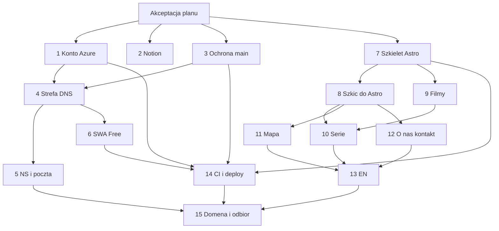

# Strona chilimango.pl v2 — plan podróży na Azure

> **Dla agentów implementujących:** REQUIRED SUB-SKILL: Use superpowers:subagent-driven-development (zalecane) albo superpowers:executing-plans, zadanie po zadaniu. Kroki mają checkboxy (`- [ ]`).
>
> **Ten dokument nie jest wdrożeniem.** Nie dodaje kodu aplikacji, infrastruktury ani konfiguracji Notion. Kod powstaje po akceptacji planu przez Bartosza Gawrona, zadanie po zadaniu.

**Cel:** Opublikować statyczną stronę o podróżach Chilimango pod domeną chilimango.pl: dwie serie filmów z kanału YouTube, mapa tras zrealizowanych i planowanych, „O nas” i kontakt, po polsku i angielsku.

**Architektura:** Jedna Azure Static Web App na planie Free serwuje build Astro. DNS domeny prowadzi strefa Azure DNS. Infrastruktura jest w Terragrunt i OpenTofu, stan leży w Azure Storage, a GitHub Actions wchodzi do Azure przez OIDC, bez sekretów. Nie ma drugiego środowiska na Azure. Gałąź `main` jest chroniona i tylko z niej idzie wdrożenie na produkcję.

**Tech stack:** Astro 7.4.0, TypeScript, Node `>=22.22.0`, npm, OpenTofu, Terragrunt, Azure Static Web Apps Free, Azure DNS, Azure Storage (stan), GitHub Actions, Entra ID (rejestracja aplikacji i federacja OIDC).

## Globalne ograniczenia

Ustalenia Bartosza z 18.10.2026. Każde zadanie je dziedziczy. Tam, gdzie plan v1 mówi coś innego, obowiązuje ten dokument.

- MVP to strona tylko o podróżach. Nie ma logowania, produktów, newslettera, Payhip, koszyka, konta czytelnika ani formularza, który zapisuje adres e-mail.
- Języki na start: polski (bez prefiksu) i angielski (prefiks `/en`). Hiszpańskiego nie ma w buildzie v2.
- Jest jeden zasób Azure Static Web App, plan Free. Nie tworzymy osobnej aplikacji dev ani test. Podgląd robi agent Cursora lokalnie albo w podglądzie swojego PR. Azure nie dostaje środowiska staging.
- Na produkcję trafia wyłącznie merge do `main` zatwierdzony przez Bartosza. GitHub Actions wdraża z `main` przez Service Principal i OIDC. W repozytorium nie ma sekretów Azure, client secret ani tokenu wdrożenia Static Web Apps.
- IaC: Terragrunt + OpenTofu. Stan w Azure Storage, uwierzytelnianie do stanu przez Entra ID, bez klucza konta w GitHubie.
- Domena chilimango.pl zostaje zarejestrowana w nazwa.pl (ustalony koniec okresu: 17.10.2027). Autorytatywny DNS przechodzi na serwery nazw Azure DNS. Propagacja 24–48 h, więc strefa i zmiana NS są przed dopięciem treści, nie po niej.
- Szkic HTML v2 od TechExperta, zaakceptowany kierunkowo, z prawdziwymi miniaturami filmów, jest źródłem układu. Agent go przenosi, nie projektuje drugiej strony. Plik szkicu nie jest w repozytorium w dniu 18.10.2026. Zadanie przeniesienia stoi, dopóki plik nie zostanie dodany.
- Żadne nowe zdjęcie dzieci, poza miniaturami już obecnymi w szkicu i na kanale YouTube, nie wchodzi do repozytorium.
- Hasło strony głównej, daty podróży odcinków 1–8 i los bloga chili-mango.com są otwarte. Do odpowiedzi obowiązują wartości domyślne z sekcji 4, a nie tekst wymyślony przez agenta.
- Ten dokument nie jest poradą prawną, podatkową ani ofertą Microsoftu.

## Status

| Pole | Wartość |
| --- | --- |
| Data planu | 18 października 2026 |
| Właściciel akceptacji | Bartosz Gawron |
| Plan v1 | `docs/plans/chilimango-www-v1.md` na gałęzi `cursor/chilimango-www-plan-b69d`, pull request [#1](https://github.com/chilimango-pl/frontend/pull/1). Tego pliku ten PR nie zmienia i nie usuwa |
| Repo | GitHub `chilimango-pl/frontend` (taką ścieżkę pokazał hosting przy pushu gałęzi v1 17.10.2026). Remote roboczy to Origin. Agent przed federacją OIDC sprawdza aktualny slug poleceniem widocznym w zadaniu 3 |
| Wynik tego etapu | tylko `docs/plans/chilimango-www-v2.md` |
| Następny krok | komentarz Bartosza: akceptuję albo lista zmian |

**S** przy zadaniu oznacza jedną sesję jednego agenta i jeden przeglądalny pull request. To nie jest czas kalendarzowy. Pole „termin” w Notion uzupełnia tylko Bartosz.

---

## 1. Co v2 zastępuje w v1

v1 opisywało stronę sprzedażową: printables, Payhip, newsletter, koło emocji, listy na aplikację i ośrodek, hosting Cloudflare Pages. v2 tego nie buduje.

Zostaje z rozpoznania v1 tylko to, co nadal jest faktem technicznym:

- 17.10.2026 Internet Archive nie miało snapshotu `chilimango.pl` (Availability API zwróciło `archived_snapshots: {}`). Nie ma starego layoutu do odwzorowania. Źródłem układu v2 jest szkic TechExperta, nie Wayback.
- Tego samego dnia `http://chilimango.pl/` oddawał parking nazwa.pl. Wyglądu parkingu nie przenosimy.

Reszta v1, w tym Brevo, Payhip, Cloudflare i trzy języki na start, nie jest zakresem v2.

## 2. Zakres MVP

| Ścieżka PL | Ścieżka EN | Rola |
| --- | --- | --- |
| `/` | `/en/` | Wejście: nazwa, hasło (sekcja 4), wejścia do dwóch serii i do mapy |
| `/serie/ameryka-srodkowa` | `/en/serie/ameryka-srodkowa` | 20 filmów playlisty Ameryka Środkowa |
| `/serie/europa` | `/en/serie/europa` | 3 filmy playlisty Europa |
| `/mapa` | `/en/mapa` | Trasy zrealizowane i planowana wyprawa |
| `/o-nas` | `/en/o-nas` | Kim jest kanał |
| `/kontakt` | `/en/kontakt` | Kontakt bez formularza zbierającego dane |
| `/prywatnosc` | `/en/prywatnosc` | Krótka informacja, kto prowadzi stronę i co robi kliknięcie w film |

Jeśli szkic używa innych ścieżek, zadanie przeniesienia zostawia ścieżki szkicu i zapisuje mapę starych ścieżek na te z tabeli albo rezygnuje z tabeli na rzecz szkicu. Nie powstają obie naraz.

Wspólne:

- Przełącznik PL/EN linkiem, `lang` na `<html>`.
- Film: miniatura z YouTube, iframe `https://www.youtube-nocookie.com/embed/{id}` dopiero po kliknięciu. Obok przycisku zdanie, że odtworzenie ładuje YouTube i może zapisać ciasteczka YouTube.
- Brak App Insights, piksela i analityki z ciasteczkami.
- Stopka: nazwa marki, link do kanału, link do prywatności. Imię, nazwisko i adres pojawiają się, gdy Bartosz je poda (decyzja D7).

## 3. Później, poza tym planem

Te rzeczy nie mają zadań w v2. Wracają jako osobny plan, gdy strona podróży stoi na własnej domenie.

| Temat | Kierunek, nie projekt |
| --- | --- |
| Logowanie | Entra External ID. Plan Free Static Web Apps ma tylko „service defined authentication” i nie ma custom authentication ([cennik SWA](https://azure.microsoft.com/en-us/pricing/details/app-service/static/)). Własny dostawca to już plan Standard albo inny hosting |
| Płatności | Stripe |
| Sklep | printables i książki |
| Rezerwacja | domki |
| Hosting po sklepie i rezerwacji | migracja z Static Web Apps na Azure Container Apps |

Do tego czasu nie ma katalogu produktów, cen, przycisku kupna, konta ani modelu domku.

## 4. Treść, którą da się już oprzeć na kanale

Kanał sprawdzony 18.10.2026:

- Adres: [youtube.com/@Chilimango](https://www.youtube.com/@Chilimango), kanał `UCDyp5L5RV4CmmbAsXdcxW6A`.
- Opis kanału: „Chilimango to my - Marta i Bartek. Podróżujemy, kręcimy filmy, jemy roślinnie, podróżujemy świadomie.” Dalej wymienia Amerykę Środkową (Dominikana, Kostaryka, Nikaragua, Salwador, Gwatemala, Meksyk) i Europę Zachodnią (Luksemburg, Belgia, Francja, Andora).
- Ten sam opis linkuje blog `https://chili-mango.com/blog/`, Instagram `https://www.instagram.com/_chilimango_/` i Facebook `https://www.facebook.com/chilimangoworld`. Na stronę wchodzą dopiero po decyzji D3 i D8.
- Playlisty z strony kanału:
  - [Ameryka Środkowa - Dominikana, Kostaryka, Salwador, Nikaragua, Gwatemala, Meksyk](https://www.youtube.com/playlist?list=PLPaMIRjW6qqvB2Fgh32HcM4wttnOQ1u5I), identyfikator `PLPaMIRjW6qqvB2Fgh32HcM4wttnOQ1u5I`, 20 identyfikatorów filmów w HTML playlisty.
  - [Europa - Francja, Belgia, Luksemburg, Andora](https://www.youtube.com/playlist?list=PLPaMIRjW6qqufkgJL_aNsanSjry60zTYL), identyfikator `PLPaMIRjW6qqufkgJL_aNsanSjry60zTYL`, 3 filmy.

RSS playlisty zwraca najwyżej 15 pozycji, więc lista 20 filmów jest z HTML playlisty plus tytułów oEmbed z 18.10.2026. Data przy filmie to data publikacji na YouTube, nie data podróży.

### 4.1. Ameryka Środkowa

| # | videoId | Tytuł | Publikacja |
| --- | --- | --- | --- |
| — | `0kEZ_dyK3wc` | Ameryka Środkowa i Dominikana z Plecakiem w 3 Miesiące / 4K | 2019-11-06 |
| 1 | `mrvSIZmhyHM` | #1 Dominikana - Wakacje na Karaibach \| Jak Samodzielnie Podróżować \| 4K | 2019-11-15 |
| 2 | `9TE8NQts6S0` | #2 Kostaryka \| Czy Wejście na Aktywny WULKAN Jest Bezpieczne? \| Krokodyle i Leniwce \| 4K | 2019-12-11 |
| 3 | `z58JuftX_Yc` | #3 Kostaryka \| Idziemy na Cmentarz Dnem Oceanu Spokojnego \| 4K | 2020-01-01 |
| 4 | `tbEMn5TWEuU` | #4 Kostaryka - Uratowaliśmy Żółwie \| Niezwykła Wycieczka \| 4K | 2020-01-18 |
| 5 | `Ks5k02lShrU` | #5 Nikaragua - Mieszkamy z Rodziną \| Nauka Hiszpańskiego i Surfing \| 4K | 2020-03-02 |
| 6 | `XRNZnQu6Mvs` | #6 Nikaragua \| Przeprawiamy Się Przez NAJWIĘKSZE JEZIORO Ameryki Środkowej \| 4K | 2020-03-12 |
| 7 | `8Dou9BRpJuc` | #7 Dlaczego Nie Ma Turystów Na Wyspie Ometepe? \| Nikaragua \| 4K | 2020-04-09 |
| 8 | `l39AQwp_80s` | #8 Niezwykłe Nocne Rozbłyski Fal Oceanicznych - Bioluminescencja \| Nikaragua \| 4k | 2020-04-18 |
| 9 | `7-3rGVgGZrE` | #9 Straciliśmy Bilety za 4700 zł i Nie Możemy Wrócić do Polski \| Granada Nikaragua \| 4K | 2020-05-03 |
| 10 | `ksFhQG2UzcY` | #10 Piekielne Jezioro Lawy \| Wulkan Masaya Nikaragua \| 4K | 2020-05-12 |
| 11 | `wT-bbaieZSI` | #11 Salwador - Tu Rządzą Gangi, Przemoc i Strach \| San Salvador \| Ameryka Centralna | 2020-06-07 |
| 12 | `D8fzd568sfs` | #12 Czy Tu Jest Bezpiecznie? \| Salwador Juayua \| 4K | 2020-06-21 |
| 13 | `Jpe-JITSIYE` | #13 W Głębi Lasu Deszczowego \| Salwador 4K | 2020-09-27 |
| 14 | `ahD_wBBBwn4` | #14 Co Jedzą Weganie w Podróży? \| Weganizm w Gwatemali \| Antigua \| 4K | 2020-10-11 |
| 15 | `u2ng-fKx4Ws` | #15 Magiczna Wioska Hipisów w Gwatemali \| San Marcos La Laguna 4K | brak w RSS z 18.10.2026 |
| 16 | `VYQbfovzJX8` | #16 Wyprawa w Głąb Gwatemali \| Pomnik Przyrody w Semuc Champey \| 4K | brak w RSS z 18.10.2026 |
| 17 | `ulBfsb9cmk4` | #17 Tikal - Ruiny Miasta Majów w Gwatemali \| Flores 4K | brak w RSS z 18.10.2026 |
| 18 | `RTrMZgT2M_s` | #18 Meksykańskie Wybrzeże, Cenoty i Turkusowa Laguna \| Tulum, Bacalar, Jukatan 4K | brak w RSS z 18.10.2026 |
| 19 | `d6lqoi_hqGc` | #19 Meksyk - Wydaliśmy Nasze Ostatnie Pieniądze \| Playa del Carmen 4K | brak w RSS z 18.10.2026 |

Miniatura: `https://i.ytimg.com/vi/{videoId}/hqdefault.jpg`.

### 4.2. Europa

| videoId | Tytuł | Publikacja |
| --- | --- | --- |
| `jc_LfYdyJfc` | Jak Wygląda Podróż w Czasie Pandemii? Europa Samochodem i Rowerem \| 4K | 2020-07-23 |
| `kVdBprxFOuM` | Francja, Andora, Belgia, Luksemburg - rowerem i samochodem. | 2021-02-06 |
| `3VxS5J5BwR4` | Weekend w Luksemburgu i Wycieczka Rowerowa do Schengen \| 4K | 2021-02-20 |

### 4.3. Hasło, daty, blog

**D1, hasło.** Na kanale są filmy Marty i Bartka we dwoje, a rozważane hasło mówi o córkach. Dopóki D1 nie wybierze zdania, `h1` to „Chilimango”, a zdanie pod nim to „Filmy z podróży.” Strona „O nas” może zacytować opis kanału o Marcie i Bartku i podlinkować kanał. Nie dodaje córek, wieku ani imion dzieci. Nie ukrywa Marty.

**D2, daty odcinków 1–8.** W tabeli są tylko daty publikacji. Przy odcinkach 1–8 nie ma daty wyjazdu, dopóki Bartosz nie poda ośmiu dat. Agent nie przepisuje daty publikacji jako daty podróży.

**D3, blog.** 18.10.2026 `chili-mango.com` nie ma rekordu A ani NS (nie rozwiązuje się). Opis kanału nadal podaje `https://chili-mango.com/blog/`. Wayback ma zrzuty: [strona główna, 21.07.2024](http://web.archive.org/web/20240721140240/https://chili-mango.com/) i [blog, 1.06.2023](http://web.archive.org/web/20230601113107/https://chili-mango.com/blog/). Do decyzji D3 strona nie linkuje chili-mango.com i nie kopiuje wpisów. Trzy wyjścia, bez czwartego w v2: przenieść wybrane wpisy na tę stronę, postawić sam link, albo nie wspominać bloga.

### 4.4. Mapa

Dwie warstwy, kraj albo region, bez wymyślonej linii GPS:

| Warstwa | Miejsca |
| --- | --- |
| Zrealizowane | Dominikana, Kostaryka, Nikaragua, Salwador, Gwatemala, Meksyk, Francja, Belgia, Luksemburg, Andora |
| Planowana wyprawa | Urugwaj, Argentyna, Panama, Kostaryka, Salwador, Floryda |

Kostaryka i Salwador są w obu warstwach (byliśmy i plan jest, żeby wrócić). Floryda jest pinezką regionu, nie całych Stanów Zjednoczonych. Jeśli szkic ma własną mapę tych miejsc, zadanie przeniesienia zostawia technikę szkicu. Jeśli szkic mapy nie ma, strona dostaje listę miejsc i prosty rysunek SVG z dwiema warstwami, bez klucza Mapbox i bez kafelków, które wymagają konta.

## 5. Repozytorium i pliki, które powstaną później

Korzeń `chilimango-pl/frontend` jest dziś pusty poza `README.md` z treścią `# frontend` na `main`. v2 zajmuje ten korzeń. Aplikacja sklepu i domków nie powstaje w tym repozytorium w v2.

```
README.md
package.json
package-lock.json
astro.config.mjs
tsconfig.json
CODEOWNERS
.github/workflows/ci.yml
.github/workflows/deploy.yml
design/sketch-v2.html          # wkłada Bartosz albo agent z załącznika, bez przeróbek
src/data/videos.ts
src/data/places.ts
src/data/site.ts
src/layouts/Base.astro
src/components/VideoCard.astro
src/components/Header.astro
src/components/Footer.astro
src/pages/index.astro
src/pages/serie/ameryka-srodkowa.astro
src/pages/serie/europa.astro
src/pages/mapa.astro
src/pages/o-nas.astro
src/pages/kontakt.astro
src/pages/prywatnosc.astro
src/pages/en/...               # te same ścieżki
src/lib/videos.test.ts
public/yt-facade.js
infra/.opentofu-version
infra/prod/terragrunt.hcl
infra/prod/main.tf
infra/role-chilimango-deploy.json
infra/bootstrap/README.md
```

`astro.config.mjs`: `site: "https://chilimango.pl"`, `output: "static"`, `i18n.locales: ["pl", "en"]`, `defaultLocale: "pl"`, `prefixDefaultLocale: false`, `trailingSlash: "never"`. Hiszpański nie wchodzi do `locales`.

`src/data/site.ts` trzyma puste stringi na hasło (po D1), e-mail kontaktowy i adres operatora. Puste hasło oznacza tekst domyślny z sekcji 4.3. Pusty e-mail oznacza, że strona kontaktu pokazuje tylko link do kanału YouTube.

## 6. Koszty

Kwoty w USD są z Azure Retail Prices API odpytanego 18.10.2026 (`https://prices.azure.com/api/retail/prices`) albo ze stron Microsoftu. Przeliczenie na złote używa kursu NBP z 16.10.2026: 1 USD = 3,8827 zł, tabela A nr 202/A/NBP/2026 ([api.nbp.pl](https://api.nbp.pl/api/exchangerates/rates/a/usd/2026-10-16/?format=json)). Azure i tak zafakturuje subskrypcję po własnym kursie i walucie konta. Złote poniżej nie są cennikiem Azure.

| Składnik | Cena ze źródła | Przeliczenie |
| --- | --- | --- |
| Static Web Apps, plan Free | 0 USD. 100 GB transferu na subskrypcję na miesiąc, po przekroczeniu strona przestaje być serwowana, bez dopłaty. 2 domeny własne na aplikację. Certyfikat TLS w cenie. Brak SLA. Opis Microsoftu: hobby i projekty osobiste | 0 zł |
| Static Web Apps Standard, tylko gdyby później odejść od Free | `Standard App` 9 USD za aplikację na miesiąc w `westeurope` (Retail Prices, meter `Standard App`, 1/Month). Nadwyżka transferu 0,20 USD/GB w `westeurope` | 9 × 3,8827 = 34,94 zł, szacunek kursem NBP |
| Strefa Azure DNS, Public Zone | Retail Prices podaje dwie stawki `Public Zone`: 0,50 USD i 0,10 USD za strefę. [Strona cennika](https://azure.microsoft.com/en-us/pricing/details/dns/) rozdziela pierwsze 25 stref i kolejne. Przy jednej strefie bierzemy 0,50 USD | 0,50 × 3,8827 = 1,94 zł |
| Zapytania DNS, Zone 1 | 0,40 USD za milion (pierwszy miliard) i 0,20 USD za milion powyżej, meter `Public Queries` | przy **szacunku** 100 tys. zapytań miesięcznie: 0,04 USD ≈ 0,16 zł. To nie jest pomiar ruchu |
| Stan OpenTofu, Hot LRS, West Europe | `Hot LRS Data Stored` 0,0196 USD za GB na miesiąc | przy **szacunku** kilku MB: poniżej 1 zł razem z drobnymi transakcjami. Nie jest to faktura |
| Budżet z alertem | 5 USD, próg ustalony przez Bartosza | 5 × 3,8827 = 19,41 zł jako próg orientacyjny |
| Entra ID Free, rejestracja aplikacji, federated credential | Rejestracja aplikacji w dzierżawie Free nie jest osobną pozycją cennika SWA ani DNS. Cennik Entra: [microsoft.com/en-us/security/business/microsoft-entra-pricing](https://www.microsoft.com/en-us/security/business/microsoft-entra-pricing). Nie tworzymy client secret i nie kupujemy Entra ID P1 | 0 USD w tym planie |
| Domena w nazwa.pl | Opłacona do 17.10.2027 według ustaleń Bartosza. Ceny odnowienia nie przepisuję, bo w tym przebiegu nie otwierałem cennika nazwa.pl | poza Azure |

Rząd wielkości podany przez Bartosza, około 2–3 zł miesięcznie za strefę DNS plus odnowienie domeny, zgadza się z samą strefą (1,94 zł) i małym ruchem zapytań. Odnowienie domeny jest płatnością raz na rok w nazwa.pl, nie co miesiąc w Azure.

Budżet 5 USD jest po to, żeby złapać pomyłkę (plan Standard, drugi zasób, resolver DNS), a nie żeby opisać oczekiwany rachunek. Oczekiwany rachunek Azure przy tym planie to strefa 0,50 USD plus grosze za zapytania i stan.

Ryzyko planu Free: [cennik SWA](https://azure.microsoft.com/en-us/pricing/details/app-service/static/) nazywa Free planem „for hobbies/personal projects”, a Standard planem produkcji. Bartosz i tak wybiera Free na v2. Jeśli później będzie potrzebne SLA albo Microsoft uzna publiczną stronę marki za poza tym opisem, ścieżka zmiany to Standard za 9 USD w `westeurope`, osobna decyzja, nie zadanie v2. Przy 100 GB transferu strona na Free przestaje odpowiadać zamiast przejść na płatność.

## 7. Konto i subskrypcja Azure

Region zasobu Static Web Apps i konta Storage: `westeurope`. W wycinku cennika Standard z 18.10.2026 jest `westeurope` i nie ma w nim `polandcentral`. Agent i tak przed pierwszym apply wykonuje sprawdzenie lokalizacji dostępnych dla Static Web Apps. Jeśli `westeurope` zniknie z listy, zatrzymuje się i nie wybiera regionu po cichu. Strefa DNS jest globalna.

Nazwy:

| Zasób | Nazwa |
| --- | --- |
| Grupa | `rg-chilimango-prod` |
| Konto Storage na stan | `stchilimangotfprod` |
| Kontener | `tfstate` |
| Blob stanu | `prod.tfstate` |
| Static Web App | `swa-chilimango` |
| Strefa DNS | `chilimango.pl` |
| Rejestracja aplikacji | `github-chilimango-prod` |
| Rola niestandardowa | `Chilimango GitHub Deploy` |
| Budżet | `budget-chilimango-monthly`, zakres: cała subskrypcja |

### 7.1. Kroki Bartosza w portalu

Agent nie zakłada konta, nie podaje karty i nie wyłącza MFA.

1. **[Bartosz]** Konto firmowe pod Chilimango, osobna dzierżawa Entra, nie prywatne konto do innych usług, jeśli da się je rozdzielić. Włącza MFA, zanim powstanie subskrypcja.
2. **[Bartosz]** Subskrypcja pay-as-you-go na tej dzierżawie. Karta i dane rozliczeniowe zostają u niego.
3. **[Bartosz]** Cost Management → Budgets. Budżet `budget-chilimango-monthly` na subskrypcję, 5 USD na miesiąc, alerty przy 50%, 80% i 100% na jego e-mail. Reset co miesiąc kalendarzowy. Zakresem jest subskrypcja, żeby alert złapał też zasób założony poza grupą.
4. **[Bartosz]** Grupa zasobów `rg-chilimango-prod` w `westeurope`.
5. **[Bartosz]** Konto Storage `stchilimangotfprod`, rodzaj StorageV2, Hot, LRS, region `westeurope`. Dostęp publiczny do blobów wyłączony. Wersjonowanie blobów włączone. Miękkie usuwanie kontenerów i blobów włączone (7 dni wystarcza na v2). Kontener `tfstate`, dostęp prywatny. Nie tworzy klucza dostępu do wklejenia w GitHub. Dostęp agenta i CI jest przez Entra ID.
6. **[Bartosz]** Entra → App registrations → `github-chilimango-prod`. Zostawia platformę bez client secret. Zapisuje Application (client) ID i Directory (tenant) ID. To nie są sekrety; trafią do GitHub Variables.
7. **[Bartosz]** Federated credential, scenariusz GitHub Actions. Issuer `https://token.actions.githubusercontent.com`. Audience `api://AzureADTokenExchange`. Subject dokładnie:

   `repo:chilimango-pl/frontend:ref:refs/heads/main`

   Jeśli slug repozytorium jest inny, subject używa tego sluga, nie tego przykładu. Nie dodaje subjectu `pull_request`. Pull request nie dostaje tokenu Azure. Opis ograniczenia subjectu: [dokumentacja federacji](https://learn.microsoft.com/en-us/entra/workload-id/workload-identity-federation-create-trust).
8. **[Bartosz]** Rola niestandardowa `Chilimango GitHub Deploy` przypisana tej aplikacji na zakres `rg-chilimango-prod`. JSON roli commituje agent w zadaniu 4, a przypisanie klika Bartosz, bo aplikacja nie nadaje sobie uprawnień. Drugie przypisanie, tylko na konto `stchilimangotfprod`: wbudowana rola Storage Blob Data Contributor. Dzięki temu stan działa na `use_azuread_auth`, bez access key.
9. **[Bartosz]** Uprawnienia roli niestandardowej, nic szerszego:

   - `Microsoft.Resources/subscriptions/resourceGroups/read`
   - `Microsoft.Resources/deployments/*`
   - `Microsoft.Web/staticSites/*`
   - `Microsoft.Network/dnsZones/*`
   - `Microsoft.Authorization/locks/read`

   Nie ma `Microsoft.Authorization/roleAssignments/write`, nie ma Contributor na subskrypcji, nie ma DNS Private Resolver.
10. **[Bartosz]** W GitHubie, w repozytorium, Variables (nie Secrets): `AZURE_CLIENT_ID`, `AZURE_TENANT_ID`, `AZURE_SUBSCRIPTION_ID`. Secrets Azure zostają puste.

Polecenia, które Bartosz może wkleić po `az login` zamiast klikać część zasobów (konto, karta, MFA i budżet i tak są w portalu):

```bash
az group create --name rg-chilimango-prod --location westeurope
az storage account create \
  --name stchilimangotfprod \
  --resource-group rg-chilimango-prod \
  --location westeurope \
  --sku Standard_LRS \
  --kind StorageV2 \
  --allow-blob-public-access false \
  --min-tls-version TLS1_2
az storage account blob-service-properties update \
  --account-name stchilimangotfprod \
  --resource-group rg-chilimango-prod \
  --enable-versioning true \
  --enable-delete-retention true \
  --delete-retention-days 7
az storage container create \
  --name tfstate \
  --account-name stchilimangotfprod \
  --auth-mode login
```

Konto Storage musi powstać zanim CI uruchomi `tofu init`, bo backend nie może stworzyć konta, w którym sam trzyma stan. Dlatego storage jest w bootstrapie, a nie w stacku OpenTofu, który z tego stanu korzysta.

### 7.2. Co agent robi w kodzie, nie w portalu

- Pliki Terragrunt/OpenTofu dla strefy DNS i Static Web App.
- JSON roli.
- Workflow, który prosi o token OIDC (`permissions: id-token: write`), loguje się `azure/login` bez sekretu i woła OpenTofu oraz wdrożenie.
- Token wdrożenia Static Web Apps, jeśli narzędzie go wymaga, jest pobierany w jobie po zalogowaniu (`az staticwebapp secrets list`) i maskowany `::add-mask::`. Nie jest zapisywany w GitHub Secrets. Log nie może go wydrukować.
- Agent nie uruchamia apply, dopóki zadanie 1 nie jest odhaczone, a pull request nie weszło na `main` za zgodą Bartosza.

## 8. DNS, NS i poczta

Stan DNS 18.10.2026, zapytanie z tego środowiska:

| Rekord | Wartość |
| --- | --- |
| NS | `ns1.nazwa.pl`, `ns2.nazwa.pl`, `ns3.nazwa.pl` |
| A i www | `85.128.128.104` |
| MX | `10 chilimango.pl` |
| TXT | `v=spf1 mx a ~all` |
| SOA | `ns1.nazwa.pl`, hostmaster `biuro.nazwa.pl` |

MX wskazuje na samą domenę, która wskazuje na adres parkingu. To wygląda jak rekord domyślny, nie jak osobny host poczty. Po zmianie rekordu A na Static Web Apps ten MX wysyłałby pocztę na adres strony, która nie przyjmuje SMTP. Dlatego MX nie może zostać „tak jak jest” po zmianie A.

**D4, zanim zmienią się serwery nazw.** Bartosz mówi, czy w nazwa.pl jest skrzynka, której używa.

- Jeśli skrzynki nie ma: strefa Azure nie dostaje tego MX ani SPF parkingu. Strona kontaktu nie podaje adresu, dopóki D7 nie poda skrzynki gdzie indziej albo później.
- Jeśli skrzynka jest: Bartosz eksportuje z panelu nazwa.pl pełną listę MX, TXT (SPF, DKIM, DMARC), CNAME i SRV poczty. Agent wpisuje te rekordy do OpenTofu jeden do jednego, z hostem poczty nazwa.pl, nie z adresem Static Web Apps. Dopiero potem Bartosz zmienia NS.
- [Pomoc nazwa.pl o zmianie delegacji](https://www.nazwa.pl/pomoc/baza-wiedzy/zmiana-delegacji-domeny/) mówi o propagacji około 24 godzin i o tym, że zewnętrzne DNS wyłączają pakiet „Bezpieczna domena” (DNSSEC nazwa.pl, Anycast, SPF/DKIM/DMARC po ich stronie). Bartosz wyłącza DNSSEC w nazwa.pl przed zmianą NS, jeśli jest włączony. Po stronie Azure SPF wraca tylko wtedy, gdy D4 mówi, że poczta zostaje.

Kolejność, żeby 24–48 h propagacji szło równolegle z budową strony:

1. Zadanie 4 tworzy pustą strefę i wypisuje cztery serwery nazw Azure (postać `ns1-XX.azure-dns.com` i kolejne; dokładne nazwy pokazuje apply, nie ten plan).
2. Zadanie 5, Bartosz, wkleja te serwery w nazwa.pl: Usługi → Domeny → konfiguruj → Zewnętrzne serwery DNS → ZMIEŃ. Potrzebne są co najmniej dwa. Panel czasem prosi o adresy IP serwerów spoza nazwa.pl; wtedy bierze je z dokumentacji Azure dla tych nazw, nie zgaduje.
3. W tym czasie strona powstaje i jest oglądana pod `https://swa-chilimango.<region>.azurestaticapps.net` (dokładny host pokaże zasób).
4. Gdy build jest gotowy, zadanie 15 dopina domenę własną. Apex i `www` zużywają limit 2 domen planu Free ([limity](https://learn.microsoft.com/en-us/azure/static-web-apps/quotas)). `www` przekierowuje na apex. Certyfikat wystawia Static Web Apps. Instrukcja wiązania: [custom domain](https://learn.microsoft.com/en-us/azure/static-web-apps/custom-domain).

Do czasu zadania 15 domena po zmianie NS może nie pokazywać ani parkingu, ani strony. To jest zamierzone: parking nie jest treścią Chilimango. Poczta nie może mieć tej przerwy, stąd D4 przed zadaniem 5.

## 9. GitHub, OIDC i workflow

Ochrona `main`, klika Bartosz, bo tylko administrator repozytorium ustawia reguły:

- Pull request jest wymagany. Bezpośredni push na `main` jest wyłączony, także dla administratorów.
- Wymagana jedna akceptacja właściciela z `CODEOWNERS`. Właścicielem jest Bartosz. Agent nie jest właścicielem i nie zatwierdza własnego PR.
- Stare akceptacje odpadają po nowym commicie.
- Wymagany zielony check `ci` z workflow pull requestu.
- Force push i usuwanie `main` wyłączone.
- Merge robi Bartosz po akceptacji. Sam fakt zielonego CI nie wdraża nic, bo wdrożenie jest na push do `main`, a na `main` nie wchodzi kod bez jego merge.

Workflow `ci.yml` na pull request: `npm ci`, `npm test`, `npm run build`, `tofu fmt -check` i `tofu validate` w `infra/prod`. Bez `azure/login`.

Workflow `deploy.yml` na push do `main`:

1. `permissions: id-token: write` i `contents: read`.
2. `azure/login` z client id, tenant id i subscription id z Variables.
3. `tofu init` z backendem `azurerm`, `use_oidc = true`, `use_azuread_auth = true`, bez access key.
4. `tofu apply -auto-approve` tylko na `main`. Na pull request nie ma apply.
5. `npm ci && npm run build`.
6. Wdrożenie katalogu `dist` do istniejącej Static Web App. Token, jeśli potrzebny, powstaje w tym jobie i jest maskowany.

Nie włączamy wbudowanych środowisk podglądu Static Web Apps (plan Free ma ich 3). Jeden zasób, jedno środowisko produkcyjne.

OpenTofu i Terragrunt są pinowane. Zadanie 4 zapisuje numer z GitHub Releases do `infra/.opentofu-version` i taki sam pin Terragrunt w workflow. Kolejne zadania nie podnoszą wersji przy okazji.

## 10. Notion

Propozycja jednej strony nadrzędnej „Chilimango” i czterech baz. Bartosz zakłada je ręcznie według tej specyfikacji (zadanie 2). Bot nie dostaje dostępu do Notion, dopóki Bartosz sam go nie zaprosi. Bez zaproszenia bot czyta ten plik w repozytorium, a statusy w Notion aktualizuje Bartosz albo bot dopiero po zaproszeniu.

### 10.1. Baza Zadania

| Pole | Typ | Wartości |
| --- | --- | --- |
| Nazwa | tytuł | jak w sekcji 12 |
| Etap | select | Konto, Infrastruktura, Strona, Wdrożenie, Notion |
| Status | select | Backlog, Gotowe do agenta, W toku, Do przeglądu Bartosza, Zaakceptowane, Zablokowane |
| Właściciel rodzaj | select | Człowiek, Bot |
| Właściciel | tekst | „Bartosz” albo nazwa bota, którą Bartosz wpisze przy zaproszeniu |
| Zależności | relacja do tej samej bazy | zadania, które muszą być Zaakceptowane |
| Link do PR | URL | pusty, dopóki PR nie istnieje |
| Kryteria akceptacji | tekst | skopiowane z zadania, nie skrócone do „działa” |
| Termin | data | puste, dopóki Bartosz nie wpisze. Bot zostawia puste |
| Rozmiar | select | S |
| Gałąź | tekst | `cursor/...` |
| Blokada | tekst | jakiej decyzji lub pliku brakuje |

Widoki:

- „Do Bartosza”: status = Do przeglądu Bartosza albo właściciel rodzaj = Człowiek i status ≠ Zaakceptowane.
- „Kolejka botów”: status = Gotowe do agenta i wszystkie zależności = Zaakceptowane.
- „W toku”: status = W toku.
- Kanban po polu Status.

### 10.2. Dziennik decyzji

| Pole | Typ |
| --- | --- |
| Decyzja | tytuł |
| Data | data |
| Status | Otwarta, Podjęta |
| Treść | tekst |
| Skutek dla v2 | tekst |
| Podjął | tekst |

Na start wpisane jako Otwarte: D1 hasło, D2 daty odcinków 1–8, D3 blog, D4 poczta, D7 e-mail i dane stopki, D8 social media. D5 (szkic) i D6 (konto Azure) są Otwarte, dopóki plik i konto nie istnieją.

Bot może dodać wpis tylko ze statusem Otwarta i zdaniem „propozycja”. Status Podjęta ustawia Bartosz.

### 10.3. Specyfikacje

| Pole | Typ |
| --- | --- |
| Nazwa | tytuł |
| Wersja | tekst, np. v2 |
| Status | Szkic, Obowiązuje, Zastąpione |
| Link | URL do pliku na `main` albo do PR |
| Data | data |

v2 startuje jako Szkic. Po komentarzu „akceptuję” Bartosz przestawia na Obowiązuje. v1, jeśli je dopisze, dostaje status Zastąpione i link do PR #1. Bot nie przestawia statusu specyfikacji.

### 10.4. Ryzyka

| Pole | Typ |
| --- | --- |
| Ryzyko | tytuł |
| Skutek | tekst |
| Mitygacja | tekst |
| Status | Otwarte, Zaakceptowane, Zamknięte |

Widok „Otwarte”. Bot dopisuje ryzyko, nie zamyka go.

### 10.5. Praca botów

1. Bot bierze tylko wiersz ze statusem Gotowe do agenta, którego zależności są Zaakceptowane.
2. Ustawia W toku, wpisuje swoją nazwę w Właściciel i rodzaj Bot, wpisuje nazwę gałęzi.
3. Robi jedno zadanie, jeden pull request. Wkleja URL w Link do PR i ustawia Do przeglądu Bartosza.
4. Nie ustawia Zaakceptowane. To robi Bartosz po merge albo po odrzuceniu wraca status do Gotowe do agenta z notatką.
5. Bot nie merguje do `main` i nie klika DNS, subskrypcji ani budżetu.
6. Gdy brakuje szkicu, dat albo hasła, bot nie zgaduje: status Zablokowane i wpis w polu Blokada.

## 11. Prywatność na v2

Strona nie prowadzi newslettera i nie ma konta. Kontakt to link `mailto`, gdy D7 poda adres, plus link do YouTube. Kliknięcie filmu ładuje `youtube-nocookie.com`. Do tego kliknięcia iframe nie ma w HTML.

Nie ma banera zgody w v2, bo strona nie wkłada identyfikatora do urządzenia przed tym kliknięciem i nie ma App Insights. Zdanie przy przycisku filmu jest informacją o YouTube. Jeśli zadanie przeniesienia znajdzie w szkicu zewnętrzny skrypt analityczny, wyrzuca go i zapisuje to w opisie PR, zamiast go przenieść.

Krótka strona prywatności: kto prowadzi stronę (dane z D7, a zanim będą: „uzupełni operator”), że film jest u YouTube po kliknięciu, że nie ma konta ani newslettera, oraz link do Prezesa UODO przez [uodo.gov.pl/pl/p/kontakt](https://uodo.gov.pl/pl/p/kontakt). Art. 81 prawa autorskiego (wizerunek) zostaje przy Bartoszu: miniatury są tymi, które i tak są na kanale i w szkicu. Agent nie dokłada kadrów dzieci.

## 12. Zadania

Wspólne kryterium zadań z kodem: diff nie zawiera client secret, tokenu SWA, klucza Storage, wpisów bloga chili-mango.com ani nowego zdjęcia dzieci. `npm test` i `npm run build` są zielone, jeśli zadanie dotyka strony.

### Zadanie 1: Konto Azure, budżet, stan, aplikacja

**Rozmiar:** S. **Zależy od:** akceptacji tego planu. **Robi:** Bartosz, sekcja 7.1. Agent nie commituje.

**Kryteria:** subskrypcja pay-as-you-go istnieje, MFA jest włączone, budżet 5 USD ma alerty 50/80/100, grupa `rg-chilimango-prod` istnieje, konto `stchilimangotfprod` ma wyłączony publiczny dostęp i włączone wersjonowanie, kontener `tfstate` istnieje, rejestracja `github-chilimango-prod` nie ma client secret, federacja wskazuje `ref:refs/heads/main` tego repozytorium, rola niestandardowa i Storage Blob Data Contributor są przypisane, w GitHub Variables są trzy identyfikatory, GitHub Secrets nie dostały wartości Azure.

- [ ] **[Bartosz]** Wykonać kroki 1–10 z sekcji 7.1.
- [ ] **[Bartosz]** Wkleić w Dziennik decyzji albo w komentarz PR numery, które nie są sekretami: nazwa subskrypcji, client id, tenant id. Bez kluczy.

### Zadanie 2: Bazy Notion

**Rozmiar:** S. **Zależy od:** akceptacji planu. Może iść równolegle z zadaniem 1. **Robi:** Bartosz.

**Kryteria:** istnieją cztery bazy z polami z sekcji 10, widoki „Do Bartosza” i „Kolejka botów”, decyzje D1–D8 mają status Otwarta, specyfikacja v2 ma status Szkic i link do tego PR.

- [ ] **[Bartosz]** Założyć bazy.
- [ ] **[Bartosz]** Wpisać zadania z sekcji 12 jako Backlog, zależności według sekcji 13.

### Zadanie 3: Ochrona main

**Rozmiar:** S. **Zależy od:** akceptacji planu. **Robi:** agent plik, Bartosz reguły.

**Pliki:** `CODEOWNERS` z linią `* @<login Bartosza>`. Login agent bierze z konta, które merguje, nie zgaduje adresu e-mail.

**Kryteria:** push commita na `main` z konta bez obejścia jest odrzucany. PR bez akceptacji Bartosza nie wchodzi. Check `ci` jest wymagany, gdy workflow z zadania 14 już jest na `main`; do tego czasu reguła checka może być dodana w zadaniu 14, co jest zapisane w tym zadaniu jako drugi krok Bartosza.

- [ ] Dodać `CODEOWNERS` i akapit w `README.md` o ochronie `main`.
- [ ] **[Bartosz]** Ustawić reguły z sekcji 9.
- [ ] Commit plików. Bez zmian w ustawieniach przez API, jeśli agent nie ma do tego uprawnienia: wtedy opis PR mówi, że krok portalu został Bartoszowi.

### Zadanie 4: Strefa DNS w OpenTofu

**Rozmiar:** S. **Zależy od:** 1 i 3. **Robi:** agent w kodzie, apply po merge Bartosza.

**Pliki:** `infra/.opentofu-version`, `infra/prod/terragrunt.hcl`, `infra/prod/main.tf`, `infra/role-chilimango-deploy.json`, `infra/bootstrap/README.md` (skrót sekcji 7.1).

**Kontrakt:** backend `azurerm` na `stchilimangotfprod` / `tfstate` / `prod.tfstate`, `use_oidc` i `use_azuread_auth`. Zasób `azurerm_dns_zone` o nazwie `chilimango.pl` w `rg-chilimango-prod`. Output `name_servers`. Brak rekordu A na parking `85.128.128.104`. Brak MX, dopóki zadanie 5 nie dostanie listy z D4. JSON roli jest zgodny z listą uprawnień z sekcji 7.1 i nie zawiera `roleAssignments/write`.

**Kryteria:** `tofu fmt -check` i `tofu validate` przechodzą lokalnie, bez logowania do Azure. Po merge Bartosz uruchamia pierwszy `tofu apply` na swoim komputerze po `az login` (to jego konto, nie Service Principal). Output pokazuje cztery serwery nazw Azure. W logu nie ma sekretu. Ten pierwszy apply jest obowiązkowy tutaj, a nie w zadaniu 14, bo zadanie 5 ma dostać serwery nazw, zanim powstanie workflow. Zadanie 14 przejmuje kolejne apply i nie tworzy drugiej strefy.

- [ ] Spiąć pin wersji, backend i strefę.
- [ ] Validate lokalnie.
- [ ] Commit i PR.
- [ ] **[Bartosz]** Zmergować i uruchomić pierwszy `tofu apply` według `infra/bootstrap/README.md`. Wkleić cztery serwery nazw do zadania 5.

### Zadanie 5: Delegacja NS i rekordy poczty

**Rozmiar:** S. **Zależy od:** 4 (output NS) i decyzji D4. **Robi:** Bartosz w nazwa.pl, agent dopisuje rekordy poczty tylko gdy D4 je poda.

**Kryteria:** `dig NS chilimango.pl` pokazuje serwery Azure, nie `ns1.nazwa.pl`. Jeśli D4 = brak skrzynki, w strefie nie ma MX na apex wskazującego na stronę. Jeśli D4 = jest skrzynka, `dig MX` pokazuje hosty podane przez Bartosza i te hosty nie są adresem Static Web Apps. Minęło okno propagacji albo Bartosz świadomie przechodzi dalej, wiedząc, że część resolverów jeszcze trzyma stare NS do 48 h.

- [ ] **[Bartosz]** Potwierdzić D4 i, jeśli trzeba, wkleić eksport rekordów.
- [ ] Agent dodać rekordy poczty do OpenTofu, gdy lista istnieje.
- [ ] **[Bartosz]** Wyłączyć DNSSEC, jeśli włączony, i zmienić NS według sekcji 8.
- [ ] Agent zapisać w opisie PR wynik `dig NS` i `dig MX`.

### Zadanie 6: Jedna Static Web App Free

**Rozmiar:** S. **Zależy od:** 4. Może iść równolegle z 5. **Robi:** agent.

**Pliki:** dopisanie `azurerm_static_web_app` w `infra/prod`. SKU Free, region `westeurope` po sprawdzeniu listy lokalizacji. Jedna aplikacja. Brak drugiego zasobu `azurerm_static_web_app`. Brak `preview_environments_enabled`, jeśli atrybut istnieje w użytej wersji providera; w przeciwnym razie komentarz w tf i brak konfiguracji staging w portalu.

**Kryteria:** po apply jest jeden zasób, SKU Free, host `*.azurestaticapps.net` odpowiada. W grupie zasobów nie ma drugiej Static Web App i nie ma planu Standard. Apply po merge robi Bartosz lokalnie, tak jak w zadaniu 4. Zadanie 14 tylko wgrywa pliki do tego zasobu.

- [ ] Dodać zasób i output `default_host_name`. Agent czyta dokumentację użytej wersji providera `azurerm_static_web_app` i nie włącza środowiska podglądu. Jeśli wyłączenie podglądu jest tylko przełącznikiem w portalu, PR wymienia jedno kliknięcie dla Bartosza.
- [ ] Commit i PR.
- [ ] **[Bartosz]** Po merge uruchomić `tofu apply` i `az staticwebapp show`.

### Zadanie 7: Szkielet Astro

**Rozmiar:** S. **Zależy od:** akceptacji planu. Nie zależy od Azure. **Robi:** agent.

**Pliki:** `package.json` z `astro@7.4.0`, `engines.node` `>=22.22.0`, skrypty `dev`, `build`, `preview`, `test`. Konfiguracja i18n z sekcji 5. `src/pages/index.astro` z `h1` „Chilimango” i zdaniem „Filmy z podróży.” `src/lib/videos.test.ts` na razie sprawdza, że `site.url` to `https://chilimango.pl`.

**Kryteria:** `npm test` i `npm run build` przechodzą. `dist/index.html` zawiera „Chilimango” i nie zawiera `payhip`, `newsletter`, `zaloguj`.

- [ ] Postawić szkielet.
- [ ] Uruchomić test i build.
- [ ] Commit.

### Zadanie 8: Przeniesienie szkicu do Astro

**Rozmiar:** S. **Zależy od:** 7 i pliku szkicu. **Robi:** agent. **Blokada:** brak `design/sketch-v2.html`.

**Pliki:** komponenty układu z sekcji 5, strony z sekcji 2, style wyciągnięte ze szkicu. Szkic zostaje w `design/` jako źródło porównania, nie jest serwowany z `public/`.

**Kryteria:** każda sekcja widoczna w szkicu ma odpowiednik w Astro. Miniatury filmów mają te same adresy `i.ytimg.com` co szkic. Nie ma formularza POST, skryptu analitycznego, linku Payhip ani przycisku logowania, nawet jeśli szkic by je miał (szkic v2 według ustaleń ich nie ma; gdyby były, agent je pomija i pisze o tym w PR). Bartosz porównuje podgląd ze szkicem i albo akceptuje, albo wskazuje różnicę. Agent nie zmienia palety „bo tak ładniej”.

- [ ] **[Bartosz]** Dodać szkic jako `design/sketch-v2.html`.
- [ ] Przenieść układ do komponentów Astro, PL.
- [ ] Build i ręczna lista sekcji w opisie PR.
- [ ] Commit.

### Zadanie 9: Dane filmów i fasada

**Rozmiar:** S. **Zależy od:** 7. Może zacząć się przed 8, a podpięcie pod układ dokończyć po 8. **Robi:** agent.

**Pliki:** `src/data/videos.ts` z tabel sekcji 4.1 i 4.2, `src/components/VideoCard.astro`, `public/yt-facade.js`.

**Kontrakt:** typ filmu ma `youtubeId`, `title`, `playlist: "ameryka" | "europa"`, `publishedOn: string | null`, `tripDate: null`. `tripDate` zostaje `null` dla wszystkich, także dla 9–19, dopóki D2 nie poda dat 1–8. Wtedy osobny, mały commit uzupełnia tylko 1–8 i nie rusza reszty. Fasada nie wstawia iframe przed kliknięciem. Źródło iframe to `youtube-nocookie.com`.

**Testy:** 20 filmów w `ameryka`, 3 w `europa`, każdy `youtubeId` pasuje do `^[A-Za-z0-9_-]{11}$`, identyfikatory playlist są dokładnie te z sekcji 4, `tripDate` jest `null`.

- [ ] Wpisać dane i testy.
- [ ] Zbudować fixture karty i sprawdzić brak iframe w HTML przed kliknięciem.
- [ ] Commit.

### Zadanie 10: Strony serii

**Rozmiar:** S. **Zależy od:** 8 i 9. **Robi:** agent.

**Kryteria:** `/serie/ameryka-srodkowa` wypisuje 20 tytułów z danych, `/serie/europa` trzy. Kolejność jest kolejnością tabeli 4.1 i 4.2. Tytuł strony serii jest tytułem playlisty. Nie ma daty podróży.

- [ ] Złożyć dwie strony z `videos.ts`.
- [ ] Test albo asercja buildu: liczba kart.
- [ ] Commit.

### Zadanie 11: Mapa

**Rozmiar:** S. **Zależy od:** 8. **Robi:** agent.

**Pliki:** `src/data/places.ts`, `src/pages/mapa.astro`.

**Kontrakt:** miejsca i warstwy dokładnie z sekcji 4.4. Kostaryka i Salwador mają obie warstwy. Brak klucza mapy w repozytorium. Jeśli szkic ma mapę, zostaje technika szkicu po sprawdzeniu, że nie woła płatnego API.

**Kryteria:** na stronie widać obie warstwy i wszystkie miejsca z tabeli. Nie ma Urugwaju w warstwie zrealizowanej i nie ma Dominikany w warstwie planu.

- [ ] Dane i strona.
- [ ] Test listy miejsc.
- [ ] Commit.

### Zadanie 12: O nas, kontakt, prywatność

**Rozmiar:** S. **Zależy od:** 8. **Robi:** agent. Tekst hasła zostaje przy domyślnym, dopóki nie ma D1.

**Kryteria:** „O nas” cytuje opis kanału o Marcie i Bartku i linkuje `@Chilimango`. Nie zawiera słów „córk” ani wieku. Kontakt bez `<form>`. Gdy `site.email` jest pusty, jest link do YouTube i nie ma zmyślonego adresu. Prywatność ma treść z sekcji 11 w PL. `chili-mango.com` nie występuje.

- [ ] Trzy strony PL.
- [ ] `rg` po `dist` dla `chili-mango.com`, `<form` i `córk` na tych stronach jest puste.
- [ ] Commit.

### Zadanie 13: Angielski

**Rozmiar:** S. **Zależy od:** 10, 11, 12. **Robi:** agent.

**Kryteria:** każda ścieżka PL ma parę pod `/en` z tym samym sluge. Przełącznik z `/mapa` prowadzi na `/en/mapa`, nie na `/en/`. `html lang="en"`. Tytuły filmów zostają w języku YouTube (nie tłumaczymy tytułów odcinków). Tłumaczone są chrome, „O nas”, kontakt, prywatność, warstwy mapy i zdanie przy filmie. Tekst EN „O nas” też nie wprowadza córek.

- [ ] Strony `src/pages/en/**` i słownik.
- [ ] Build `dist/en/serie/europa/index.html` istnieje.
- [ ] Commit.

### Zadanie 14: CI i deploy

**Rozmiar:** S. **Zależy od:** 1, 3, 6, 7. **Robi:** agent w kodzie, Bartosz merguje pierwszy raz.

**Pliki:** `.github/workflows/ci.yml`, `.github/workflows/deploy.yml`.

**Kryteria:** PR z tym zadaniem ma zielony `ci` bez wywołania Azure (log nie zawiera `azure/login`). Po merge do `main` job deploy loguje się przez OIDC, kończy się wdrożeniem i adres `*.azurestaticapps.net` pokazuje `h1` Chilimango. W GitHub Secrets nadal nie ma wpisu Azure. Check `ci` zostaje wymagany na `main`, jeśli zadanie 3 zostawiło to Bartoszowi.

- [ ] Dodać oba workflow zgodnie z sekcją 9.
- [ ] **[Bartosz]** Zmergować po zielonym CI.
- [ ] Sprawdzić host SWA i pustą listę sekretów związaną z tym wdrożeniem.
- [ ] Commit.

### Zadanie 15: Domena własna i odbiór

**Rozmiar:** S. **Zależy od:** 5, 13, 14 oraz D1 i D7, jeśli mają zmienić tekst przed produkcją. **Robi:** agent rekordy i hostname, Bartosz akceptuje odbiór.

**Kryteria odbioru całości,** wszystkie naraz:

1. `https://chilimango.pl` pokazuje stronę, certyfikat jest wystawiony na tę nazwę.
2. `https://www.chilimango.pl` kończy na apex.
3. `http://chilimango.pl` kończy na HTTPS apex.
4. PL i EN: strona główna, obie serie, mapa, o nas, kontakt, prywatność.
5. Ameryka pokazuje 20 filmów, Europa 3, iframe pojawia się po kliknięciu i używa `youtube-nocookie`.
6. Mapa ma warstwy z sekcji 4.4.
7. Hasło jest albo domyślne „Filmy z podróży.”, albo zdaniem z D1. Nie ma trzeciej wersji.
8. Nie ma logowania, newslettera, Payhip, cen i chili-mango.com, dopóki D3 nie każe dodać linku osobnym zadaniem.
9. `dig NS` pokazuje Azure. MX jest zgodny z D4.
10. W grupie jest jedna Static Web App, SKU Free. Budżet 5 USD jest włączony.
11. Ostatni deploy poszedł z `main` po akceptacji Bartosza, bez sekretu w repozytorium.

- [ ] Dodać rekordy domeny i hostname według dokumentacji Static Web Apps.
- [ ] Przejść listę 1–11 i wpisać wyniki w PR.
- [ ] **[Bartosz]** Odhaczyć odbiór komentarzem.

## 13. Kolejność



Zadania 2, 7 i 3 startują zaraz po akceptacji planu. Zadanie 5 jest wczesne względem treści, bo propagacja DNS trwa 24–48 h, ale nie wcześniej niż D4 i output nazw z zadania 4.

| Zadanie | Kto blokuje poza kodem |
| --- | --- |
| 1, 2, 5 | Bartosz |
| 3 | Bartosz klika reguły, agent daje plik |
| 4, 6, 14 | pierwszy merge i apply: Bartosz |
| 8 | plik szkicu |
| 15 | D1 i D7, jeśli tekst produkcji ma być inny niż domyślny; D4 już rozstrzygnięte w 5 |

## 14. Ryzyka

| Ryzyko | Skutek | Co robi plan |
| --- | --- | --- |
| Plan Free jest opisany jako hobby/personal i nie ma SLA | Publiczna strona marki bez umowy o dostępności; po 100 GB transferu strona gaśnie | Zostajemy przy decyzji Bartosza. Próg 9 USD Standard jest zapisany, nie wdrażany. Budżet 5 USD złapie zmianę SKU |
| Zmiana NS przed rekordami poczty | Poczta pada, bo MX parkingu wskazywał na apex | D4 i zakaz kopiowania MX na adres SWA |
| Propagacja 24–48 h | Część sieci jeszcze widzi parking albo nic | NS idzie w zadaniu 5, zanim skończy się treść. Odbiór sprawdza `dig` z więcej niż jednego resolvera |
| DNSSEC włączony przy zmianie NS | Domena znika | Krok wyłączenia w zadaniu 5 |
| Subject OIDC za szeroki | Pull request obcego wkładu dostaje Azure | Subject tylko `ref:refs/heads/main`. Brak `pull_request` |
| Rola Contributor na subskrypcji | Agent może założyć drogie zasoby | Rola z sekcji 7.1 tylko na grupę, plus Blob Data Contributor tylko na konto stanu |
| Stan w kontenerze, który stack sam kasuje | Utrata stanu | Storage jest w bootstrapie, poza stackiem |
| Szkic nie dotrze | Agent wymyśli drugi układ | Zadanie 8 jest zablokowane bez pliku |
| Hasło o córkach przy filmach we dwoje | Strona obiecuje inny film niż jest na kanale | Domyślne hasło neutralne do czasu D1 |
| Daty publikacji wzięte za daty wyjazdu | Fałszywa oś czasu odcinków 1–8 | `tripDate` zostaje `null` |
| Link do chili-mango.com | 404, domena się nie rozwiązuje | Brak linku do decyzji D3 |
| Miniatury dzieci | Wizerunek już publiczny na YouTube; dokładanie kadrów pogarsza sprawę | Tylko miniatury ze szkicu i z listy videoId |
| Jeden limit 2 domen na Free | Trzecia domena się nie podepnie | Apex i www, nic więcej |
| Podglądy SWA włączone przy wielu PR | Limit 3 środowisk Free | Zakaz środowisk podglądu. Podgląd jest lokalny i w Cursorze |

## 15. Decyzje Bartosza

| ID | Pytanie | Wartość do czasu odpowiedzi | Blokuje |
| --- | --- | --- | --- |
| D1 | Hasło strony głównej: córki, para, czy inne zdanie | „Filmy z podróży.”, bez córek i bez ukrywania Marty na „O nas” | tekst produkcji w zadaniu 15, nie blokuje szkieletu |
| D2 | Daty wyjazdu odcinków 1–8 | brak dat wyjazdu; daty publikacji zostają tylko w danych jako publikacja | nic, dopóki nie chce ich pokazać |
| D3 | Blog chili-mango.com: przenieść, linkować, czy pominąć | pominąć. Domena nie rozwiązuje się 18.10.2026. Archiwum istnieje | link i treść bloga |
| D4 | Czy na nazwa.pl jest używana skrzynka | brak odpowiedzi blokuje zmianę NS | zadanie 5 |
| D5 | Szkic HTML v2 | zadanie 8 czeka na `design/sketch-v2.html` | przeniesienie układu |
| D6 | Konto firmowe Azure i karta | bez tego nie ma apply | zadanie 1 |
| D7 | E-mail kontaktu i dane stopki (imię, nazwisko, adres, jeśli mają być publiczne) | kontakt = sam YouTube, stopka bez zmyślonego adresu | zadanie 15, jeśli dane mają być na produkcji |
| D8 | Czy dodać Instagram i Facebook z opisu kanału | nie dodawać | linki w stopce |

Odpowiedź „zostawiam domyślne” przy D1, D2, D3 i D8 wystarcza. D4, D5 i D6 nie mają bezpiecznego domyślnego „zrób mimo braku”.

## 16. Źródła

- Kanał i opisy, 18.10.2026: [youtube.com/@Chilimango](https://www.youtube.com/@Chilimango), playlisty `PLPaMIRjW6qqvB2Fgh32HcM4wttnOQ1u5I` i `PLPaMIRjW6qqufkgJL_aNsanSjry60zTYL`, tytuły przez `https://www.youtube.com/oembed`.
- chili-mango.com bez rekordów DNS 18.10.2026 (`dig` pusty). Zrzuty: [20240721140240](http://web.archive.org/web/20240721140240/https://chili-mango.com/), [blog 20230601113107](http://web.archive.org/web/20230601113107/https://chili-mango.com/blog/).
- Astro 7.4.0, Node `>=22.22.0`: `npm view astro version engines` 18.10.2026.
- Cennik SWA: [azure.microsoft.com/en-us/pricing/details/app-service/static](https://azure.microsoft.com/en-us/pricing/details/app-service/static/). Limity: [learn.microsoft.com quotas](https://learn.microsoft.com/en-us/azure/static-web-apps/quotas). Domena: [custom domain](https://learn.microsoft.com/en-us/azure/static-web-apps/custom-domain).
- Retail Prices 18.10.2026: Static Web Apps `Standard App` 9 USD / miesiąc w `westeurope`; nadwyżka 0,20 USD/GB w `westeurope`; Azure DNS `Public Zone` 0,50 USD i 0,10 USD; `Public Queries` 0,40 USD i 0,20 USD za milion; Storage `Hot LRS Data Stored` 0,0196 USD za GB-miesiąc w `westeurope`. API: `https://prices.azure.com/api/retail/prices`. Strona cennika DNS: [azure.microsoft.com/pricing/details/dns](https://azure.microsoft.com/en-us/pricing/details/dns/).
- Kurs: NBP 16.10.2026, USD 3,8827, [tabela A](https://api.nbp.pl/api/exchangerates/rates/a/usd/2026-10-16/?format=json).
- Federacja GitHub: [learn.microsoft.com workload-identity-federation-create-trust](https://learn.microsoft.com/en-us/entra/workload-id/workload-identity-federation-create-trust).
- Entra pricing: [microsoft.com entra pricing](https://www.microsoft.com/en-us/security/business/microsoft-entra-pricing).
- Delegacja nazwa.pl: [pomoc nazwa.pl](https://www.nazwa.pl/pomoc/baza-wiedzy/zmiana-delegacji-domeny/).
- UODO, kontakt bez wpisywania ulicy z pamięci: [uodo.gov.pl/pl/p/kontakt](https://uodo.gov.pl/pl/p/kontakt).
